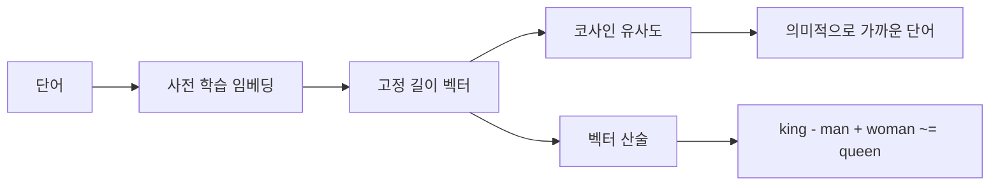

# Chapter 1 Exercise Vector Space

- 노트북: [Chapter_1_Exercise_Vector Space.ipynb](../Chapter_1_Exercise_Vector Space.ipynb)
- 학습 주제: 단어 벡터와 의미 공간
- 대상 독자: 파이썬은 익숙하지만 `torch`와 Transformer/GPT 내부 구조는 처음 보는 개발자

## 핵심 흐름

## 노트북 설명

이 노트북은 단어 벡터와 의미 공간를 실습 코드로 따라가며, 문자열/토큰/텐서/모델 출력이 어떻게 연결되는지 확인하는 자료입니다. 각 코드 셀에는 셀 목적, torch 관점, 실행 후 확인할 포인트를 주석으로 추가했습니다. 처음 읽을 때는 세부 수식보다 텐서의 차원 변화와 `nn.Module.forward()`의 입출력을 우선 추적하세요.

## 학습 목표

- 단어가 숫자 벡터로 표현되는 이유를 이해합니다.
- 유사도와 벡터 산술이 의미 관계를 어떻게 드러내는지 확인합니다.
- 이후 토큰 임베딩과 Transformer 입력의 직관을 준비합니다.

## torch 관점에서 볼 부분

- 임베딩은 torch Tensor와 같은 밀집 숫자 벡터로 생각할 수 있습니다.
- 유사도 계산은 벡터 내적과 정규화의 조합입니다.

## 추천 읽기 순서

1. 데이터가 문자열에서 토큰 ID 또는 텐서로 바뀌는 지점을 찾습니다.
2. 모델 계층이 입력 텐서를 어떤 shape으로 받아 어떤 shape으로 반환하는지 확인합니다.
3. loss 또는 평가 지표가 어떤 출력과 정답을 비교하는지 확인합니다.
4. 생성, 분류, 평가처럼 노트북의 최종 목적에 해당하는 셀을 다시 실행하며 전체 흐름을 연결합니다.

## 자주 헷갈리는 포인트

- `logits`는 확률이 아니라 정규화되지 않은 점수입니다.
- `batch` 차원은 여러 샘플을 한 번에 처리하기 위해 앞에 붙는 차원입니다.
- `sequence_length`는 한 샘플 안의 토큰 개수이며, GPT에서는 시간축처럼 다룹니다.
- `vocab_size` 차원은 다음 토큰 후보 전체에 대한 점수입니다.
