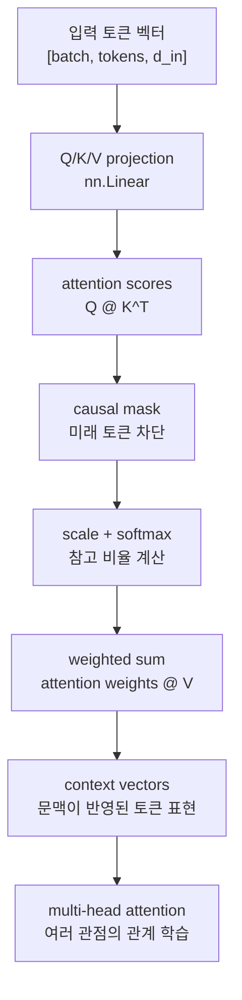

# Chapter 3 Exercise Attention

- 노트북: [Chapter_3_Excercise_Attention.ipynb](../Chapter_3_Excercise_Attention.ipynb)
- 상세 다이어그램: [diagrams/Chapter_3_Excercise_Attention.md](diagrams/Chapter_3_Excercise_Attention.md)
- 학습 주제: causal self-attention과 multi-head attention
- 대상 독자: Python은 알지만 `torch`, Transformer, GPT 내부 구조는 처음 보는 개발자

## 강의 오버뷰

이 강의는 GPT가 문장을 읽을 때 "각 토큰이 이전 토큰 중 무엇을 얼마나 참고해야 하는가"를 계산하는 attention 메커니즘을 직접 구현합니다. 단순히 공식을 외우는 것이 아니라, 입력 텐서가 Query, Key, Value로 바뀌고, attention score와 mask를 거쳐 context vector가 되는 흐름을 코드와 shape로 따라갑니다.

## 왜 배우는가

- GPT는 다음 토큰을 예측할 때 앞의 문맥을 참고해야 합니다.
- attention은 "현재 토큰이 어떤 과거 토큰을 중요하게 볼지"를 학습하는 핵심 장치입니다.
- causal mask는 미래 토큰을 보지 못하게 막아서 GPT가 실제 생성 조건과 같은 방식으로 학습/추론하게 만듭니다.
- multi-head attention은 여러 관점에서 문맥 관계를 동시에 보게 해 줍니다.

## 무엇을 배우는가

- `nn.Linear`로 입력 벡터를 Query, Key, Value로 투영하는 방법
- `queries @ keys.transpose(...)`가 토큰 간 관련도 행렬을 만드는 방식
- `masked_fill_(..., -torch.inf)`와 `softmax`로 미래 토큰 확률을 0으로 만드는 방식
- attention weight로 Value를 가중합해 context vector를 만드는 방식
- 여러 attention head를 병렬로 사용하고 다시 합치는 방식

## 핵심 흐름

## 코드가 하는 일

- `CausalAttention`은 한 개의 masked self-attention head를 구현합니다.
- 샘플 문장 벡터를 batch로 만든 뒤 attention 결과의 shape를 확인합니다.
- `MultiHeadAttentionWrapper`는 여러 `CausalAttention` 모듈을 독립적으로 실행한 뒤 결과를 이어 붙입니다.
- `MultiHeadAttention`은 실제 GPT에서 쓰는 방식에 가깝게, 하나의 Q/K/V projection 결과를 여러 head로 쪼갠 뒤 다시 합칩니다.

## 배우고 나면 알게 되는 것

- GPT의 attention block이 입력 `[batch, tokens, embedding]`을 어떻게 다시 `[batch, tokens, embedding]` 형태의 문맥화된 표현으로 바꾸는지 설명할 수 있습니다.
- attention score, attention weight, context vector의 차이를 구분할 수 있습니다.
- causal mask가 왜 필요한지, softmax 이전에 `-inf`를 넣는 이유를 이해할 수 있습니다.
- Chapter 4의 `TransformerBlock` 안에 들어가는 attention 모듈을 낯설지 않게 읽을 수 있습니다.

## 추천 읽기 순서

1. `inputs`와 `batch`의 shape를 먼저 확인합니다.
2. `CausalAttention.forward()`에서 Q/K/V, score, weight, context vector의 shape를 따라갑니다.
3. mask가 score 행렬의 어느 위치를 막는지 확인합니다.
4. `MultiHeadAttentionWrapper`와 `MultiHeadAttention`의 차이를 비교합니다.
5. 마지막으로 Chapter 4의 `TransformerBlock`에서 이 attention이 어디에 들어가는지 연결해서 봅니다.

## 자주 헷갈리는 포인트

- `attn_scores`는 아직 확률이 아니라 관련도 점수입니다.
- `attn_weights`는 `softmax`를 거친 참고 비율이며, 마지막 차원의 합이 1입니다.
- `values`는 실제로 섞이는 정보이고, Query/Key는 무엇을 얼마나 참고할지 정하는 데 쓰입니다.
- causal attention은 현재 토큰과 과거 토큰만 볼 수 있고, 미래 토큰은 볼 수 없습니다.
- multi-head는 같은 입력을 여러 관점으로 보는 구조이지, 단순히 같은 계산을 반복하는 장식이 아닙니다.
