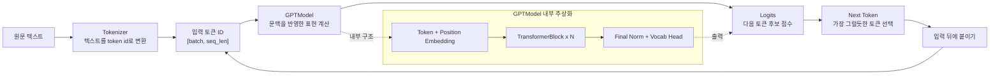
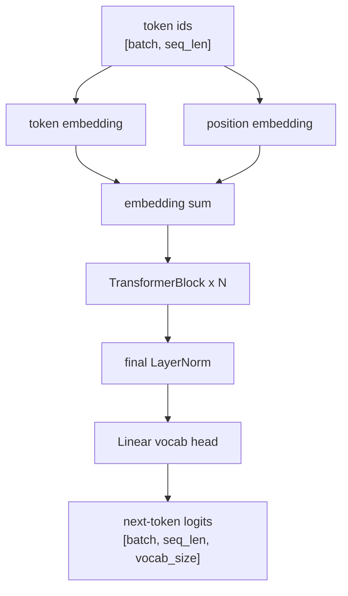

# Chapter 4 Exercise GPT

- 노트북: [Chapter_4_Excercise_GPT.ipynb](../Chapter_4_Excercise_GPT.ipynb)
- 상세 다이어그램: [diagrams/Chapter_4_Excercise_GPT.md](diagrams/Chapter_4_Excercise_GPT.md)
- 학습 주제: GPT 모델 구조를 PyTorch `nn.Module`로 직접 조립하기
- 대상 독자: Chapter 3 attention을 본 뒤, GPT 전체 모델이 어떻게 구성되는지 알고 싶은 개발자

## Overview Diagram

## 강의 오버뷰

이 강의는 Chapter 3에서 만든 multi-head attention을 GPT 모델의 한 부품으로 넣고, 토큰 입력부터 다음 토큰 logits 출력까지 이어지는 전체 구조를 구현합니다. 핵심은 "GPT는 거대한 하나의 함수이며, 입력 토큰 ID를 받아 각 위치마다 다음 토큰 후보 점수를 낸다"는 관점입니다.

## 왜 배우는가

- attention만으로는 GPT 모델이 완성되지 않습니다.
- GPT는 token embedding, position embedding, transformer block, layer norm, output head가 조립된 구조입니다.
- 텍스트 생성은 모델을 한 번 실행하는 것으로 끝나지 않고, 예측한 토큰을 다시 입력 뒤에 붙이는 반복 루프입니다.

## 무엇을 배우는가

- 토큰 ID를 embedding vector로 바꾸는 `nn.Embedding`
- 위치 정보를 더하는 position embedding
- `LayerNorm`, `MultiHeadAttention`, `FeedForward`, residual connection으로 구성된 `TransformerBlock`
- 여러 `TransformerBlock`을 쌓아 GPT 본체를 만드는 방식
- 최종 hidden state를 vocabulary 크기의 `logits`로 바꾸는 output head
- greedy decoding으로 다음 토큰을 반복 생성하는 기본 추론 루프

## 핵심 흐름

## 코드가 하는 일

- Chapter 2의 dataset/dataloader 코드를 다시 포함합니다.
- Chapter 3의 `MultiHeadAttention`을 GPT 내부 attention 모듈로 사용합니다.
- `LayerNorm`, `GELU`, `FeedForward`를 직접 구현합니다.
- `TransformerBlock`을 만들고, 이를 여러 층 쌓아 `GPTModel`을 구성합니다.
- `generate_text_simple()`로 시작 문장 뒤에 새 토큰을 반복해서 붙입니다.

## 배우고 나면 알게 되는 것

- GPT의 입력과 출력 shape가 왜 `[batch, sequence_length] -> [batch, sequence_length, vocab_size]`인지 설명할 수 있습니다.
- Transformer block 안에서 attention, feed-forward, residual, layer norm이 어떤 순서로 작동하는지 이해할 수 있습니다.
- 모델이 "문장 하나"를 출력하는 것이 아니라 "다음 토큰 후보 점수"를 출력한다는 점을 구분할 수 있습니다.
- 추론 루프가 logits에서 다음 토큰 ID를 고르고, 그 ID를 다시 입력에 붙이는 반복 구조임을 이해할 수 있습니다.

## 추천 읽기 순서

1. `GPTDatasetV1`은 복습으로 보고, 입력/타깃이 한 칸 밀린 구조라는 점만 확인합니다.
2. `MultiHeadAttention`은 Chapter 3과 연결해서 봅니다.
3. `LayerNorm`, `GELU`, `FeedForward`는 TransformerBlock의 보조 부품으로 봅니다.
4. `TransformerBlock.forward()`에서 residual connection 두 번의 흐름을 따라갑니다.
5. `GPTModel.forward()`에서 token id가 logits로 바뀌는 shape를 따라갑니다.
6. `generate_text_simple()`에서 logits의 마지막 위치만 사용해 다음 토큰을 고르는 이유를 확인합니다.

## 자주 헷갈리는 포인트

- `logits`는 확률이 아니라 정규화되지 않은 점수입니다.
- GPT는 전체 문장을 한 번에 "완성"하지 않고, 다음 토큰 하나를 고르는 작업을 반복합니다.
- `seq_len`은 현재 입력 길이이고, `context_length`는 모델이 허용하는 최대 길이입니다.
- position embedding은 단어 의미가 아니라 "몇 번째 위치인가"를 알려주는 벡터입니다.
- residual connection은 원래 입력을 다시 더해 깊은 네트워크에서 정보와 gradient가 잘 흐르게 합니다.
