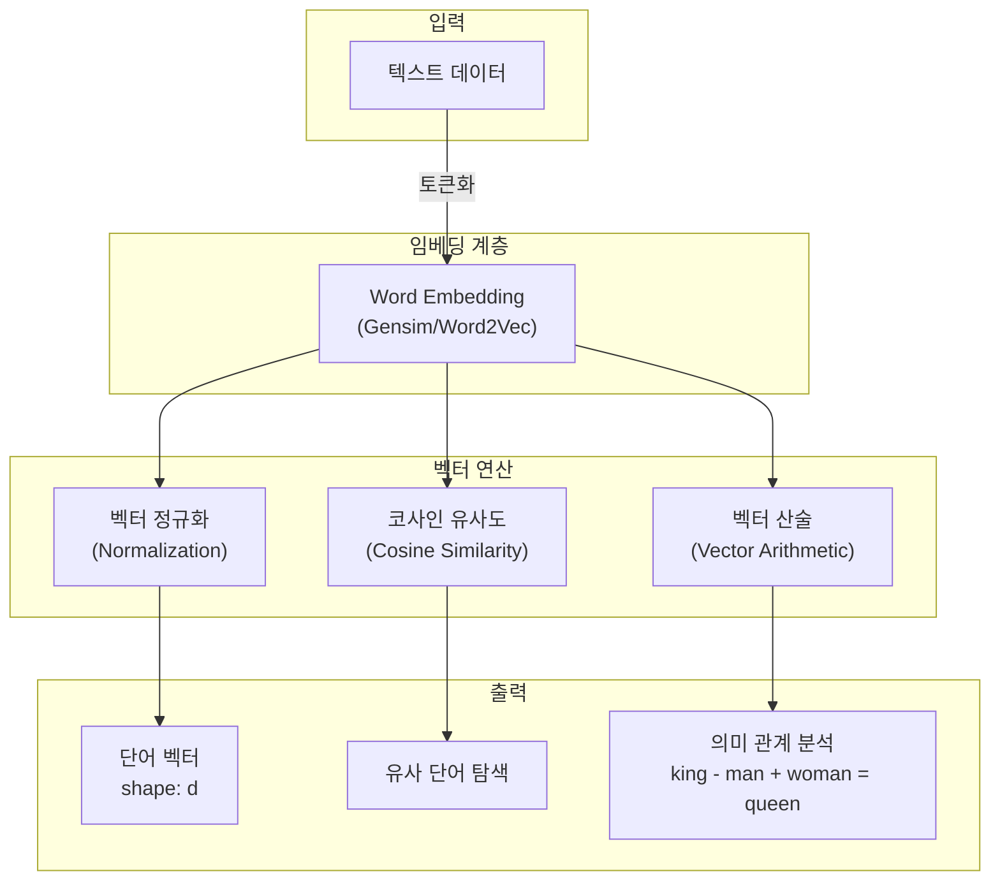

# Chapter 1: 단어 벡터와 의미 공간 (Word Vectors and Semantic Space)

## 📚 개요
이 장에서는 단어가 어떻게 숫자 벡터로 표현되고, 이 벡터들이 어떻게 의미적 관계를 드러내는지 학습합니다.

---

## 🏗️ 아키텍처 다이어그램

---

## 📖 상세 설명

### 1️⃣ **입력 데이터**
- 대규모 텍스트 말뭉치(Corpus)
- 단어 간 문맥 관계가 풍부한 데이터

### 2️⃣ **임베딩 계층 (Embedding Layer)**
- **Word2Vec (Gensim 사용)**
  - CBOW: 주변 단어로부터 중심 단어 예측
  - Skip-gram: 중심 단어로부터 주변 단어 예측
  - 결과: 각 단어를 d차원의 밀집 벡터로 표현

### 3️⃣ **벡터 연산**
- 벡터 정규화: L2 정규화로 방향만 고려
- 코사인 유사도: 두 벡터 사이의 각도로 유사도 측정
- 벡터 산술: 의미 관계 표현 (king - man + woman ≈ queen)

### 4️⃣ **출력**
- 단어 벡터: d차원의 밀집 수치 벡터
- 유사 단어 탐색: 코사인 유사도로 가장 유사한 단어 찾기
- 의미 관계 분석: 벡터 산술로 유추 문제 풀이

---

## 🎯 핵심 포인트

| 개념 | 설명 |
|------|------|
| **임베딩 차원 (d)** | 보통 100~300차원, 정보 밀도와 계산량의 trade-off |
| **정규화의 이유** | 벡터 방향(각도)만 중요하므로 크기는 제거 |
| **왜 벡터 산술이 작동하나?** | 학습 과정에서 의미적 방향이 자동으로 인코딩됨 |

---

## 💡 다음 장과의 연결
- **Chapter 2**: 토큰화된 텍스트를 임베딩하는 과정
- **Chapter 3~4**: Transformer 아키텍처에서 토큰 임베딩 활용
