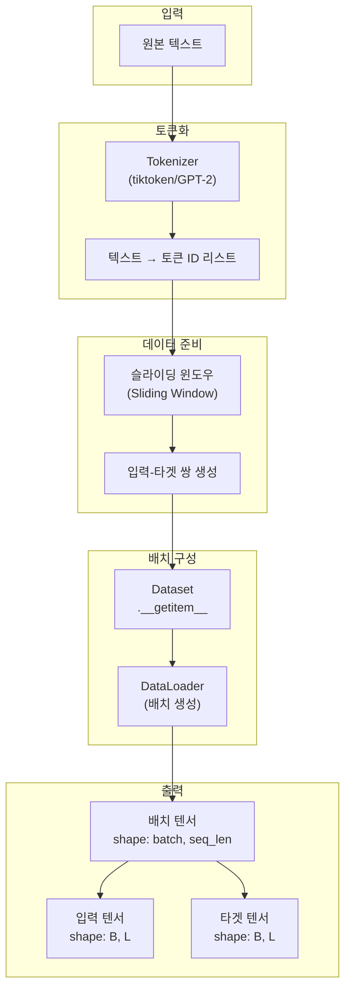

# Chapter 2: 토큰화와 GPT 데이터셋 (Tokenization and Dataset)

## 📚 개요
이 장에서는 텍스트가 어떻게 토큰 ID로 변환되고, 학습을 위해 입력-타겟 쌍으로 준비되는지 학습합니다.

---

## 🏗️ 아키텍처 다이어그램



---

## 📖 상세 설명

### 1️⃣ **입력: 원본 텍스트**
```
"Hello, do you like tea? <|endoftext|> In the sunlit terraces..."
```

### 2️⃣ **토큰화 (Tokenization)**

#### 🔹 **Tokenizer (tiktoken - GPT-2)**
- OpenAI의 BPE(Byte Pair Encoding) 기반
- 언어 효율적 분할로 vocab 크기 약 50,257

```python
tokenizer = tiktoken.get_encoding("gpt2")
text = "Hello, do you like tea?"
token_ids = tokenizer.encode(text, allowed_special={"<|endoftext|>"})
# 결과: [15496, 11, 466, 345, 588, 8887, 30, ...]
```

#### 🔹 **인코딩 & 디코딩**
- **encode()**: 텍스트 → 토큰 ID 리스트
- **decode()**: 토큰 ID 리스트 → 텍스트 복원

```python
integers = tokenizer.encode(text)      # 텍스트 → ID
strings = tokenizer.decode(integers)   # ID → 텍스트
```

### 3️⃣ **데이터 준비**

#### 🔹 **슬라이딩 윈도우 (Sliding Window)**
- 최대 시퀀스 길이(max_length) 지정
- stride만큼 이동하며 청크(chunk) 생성
- 메모리 효율적 & 데이터 재사용

```
원본: [0, 1, 2, 3, 4, 5, 6, 7, 8, 9]
max_length=4, stride=2

청크 0: [0, 1, 2, 3]
청크 1: [2, 3, 4, 5]
청크 2: [4, 5, 6, 7]
청크 3: [6, 7, 8, 9]
```

#### 🔹 **입력-타겟 쌍 생성 (Next-Token Prediction)**
- **입력**: 토큰 ID [0:L]
- **타겟**: 토큰 ID [1:L+1] (입력보다 1칸 뒤)

```
원본 토큰: [A, B, C, D, E]

입력:  [A, B, C, D]
타겟:  [B, C, D, E]  ← 다음 토큰 예측 문제
```

### 4️⃣ **배치 구성**

#### 🔹 **Dataset 클래스**
- `__len__()`: 총 샘플 수
- `__getitem__(idx)`: 특정 인덱스의 입력-타겟 쌍 반환

#### 🔹 **DataLoader**
- 여러 샘플을 배치 차원으로 묶음
- 배치 텐서 생성

```python
# DataLoader 출력
batch_input:  shape (batch_size=4, seq_len=256)
batch_target: shape (batch_size=4, seq_len=256)
```

---

## 📊 텐서 흐름 예시

| 단계 | 데이터 | 형태 | 설명 |
|------|--------|------|------|
| 1️⃣ 토큰화 | `[15496, 11, 466, ...]` | List[int] | 토큰 ID 리스트 |
| 2️⃣ 청크 생성 | 각 청크 = `[15496, 11, 466, 345]` | List[int] | 고정 길이 청크 |
| 3️⃣ 텐서 변환 | `torch.tensor(chunk)` | shape (seq_len,) | 1D 텐서 |
| 4️⃣ 배치 구성 | `DataLoader` 출력 | shape (batch, seq_len) | 2D 배치 텐서 |

---

## 🎯 핵심 포인트

| 개념 | 설명 |
|------|------|
| **토큰화** | 유연하고 효율적인 텍스트 분할 방식 |
| **슬라이딩 윈도우** | 데이터 재사용 & 메모리 효율성 |
| **입력-타겟 오프셋** | Next-token prediction의 핵심 |
| **배치 구성** | 병렬 처리로 학습 효율 향상 |

---

## 💡 중요한 포인트

```python
# 슬라이딩 윈도우 이해
for i in range(0, len(token_ids) - max_length, stride):
    input_chunk = token_ids[i:i + max_length]
    target_chunk = token_ids[i + 1: i + max_length + 1]
    # target은 input보다 1칸 뒤 (다음 토큰 예측)
```

---

## 🔗 다음 장과의 연결
- **Chapter 3**: 이 토큰 임베딩을 Attention 메커니즘에 입력
- **Chapter 4**: 전체 GPT 모델에서 Dataset → Model → Loss 파이프라인
