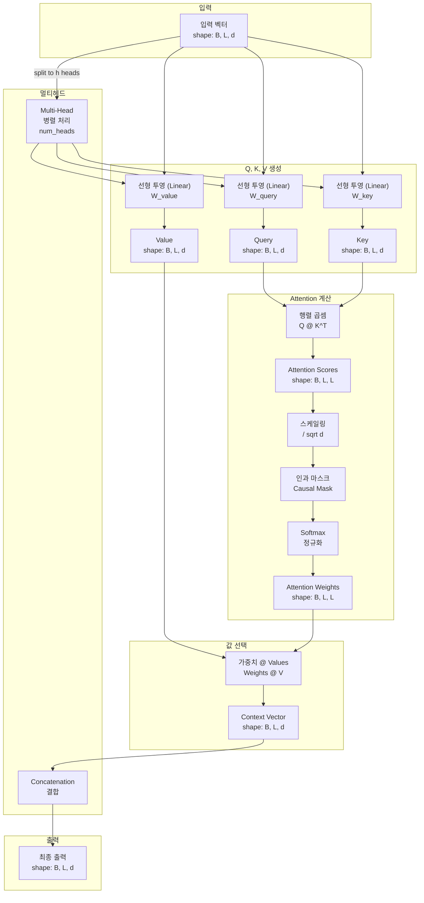

# Chapter 3: Self-Attention과 Multi-Head Attention (Attention Mechanisms)

## 📚 개요
이 장에서는 Transformer의 핵심인 Self-Attention 메커니즘과 Multi-Head Attention의 동작 방식을 학습합니다.

---

## 🏗️ 아키텍처 다이어그램



---

## 📖 상세 설명

### 1️⃣ **입력 (Input)**

```
입력 벡터: shape (Batch, Sequence_Length, Embedding_Dim)
예: (B=4, L=256, d=768)
```

### 2️⃣ **Q, K, V 생성 (Query, Key, Value Projection)**

#### 🔹 **선형 투영 (Linear Layers)**
```python
W_query = nn.Linear(d_in, d_out)
W_key = nn.Linear(d_in, d_out)
W_value = nn.Linear(d_in, d_out)

Query = W_query(x)    # shape: (B, L, d)
Key = W_key(x)        # shape: (B, L, d)
Value = W_value(x)    # shape: (B, L, d)
```

#### 🔹 **각 역할**
- **Query (Q)**: "내가 찾는 정보가 무엇인가?"
- **Key (K)**: "나는 어떤 정보를 가진 위치인가?"
- **Value (V)**: "실제 정보 내용은 무엇인가?"

### 3️⃣ **Attention 점수 계산 (Attention Score Computation)**

#### 🔹 **행렬 곱셈 (Scaled Dot-Product)**
```python
scores = Q @ K^T  # shape: (B, L, L)
# 각 query가 모든 key와 얼마나 유사한지 계산
```

#### 🔹 **스케일링 (Scaling)**
```python
scores = scores / sqrt(d)
# 큰 d값에서 softmax 그래디언트 안정화
```

#### 🔹 **인과 마스크 (Causal Mask)**
- 미래 위치(i > j)를 -∞로 마스킹
- 미래 정보 참조 방지 (autoregressive)

```python
mask = torch.triu(torch.ones(L, L), diagonal=1)
scores = scores.masked_fill(mask == 1, float('-inf'))

# 결과:
# position 0: 자기 자신만 attend
# position 1: position 0, 1만 attend
# position 2: position 0, 1, 2만 attend
```

#### 🔹 **Softmax 정규화 (Attention Weights)**
```python
weights = softmax(scores, dim=-1)  # shape: (B, L, L)
weights = Dropout(weights)  # 학습 중 정규화
```

### 4️⃣ **Context 벡터 생성 (Context Vector Generation)**

```python
context = weights @ V  # shape: (B, L, d)
# 각 위치의 최종 값은 모든 value의 가중 평균
```

### 5️⃣ **멀티 헤드 (Multi-Head Attention)**

#### 🔹 **개념**
- 여러 개의 attention head를 병렬로 실행
- 각 head는 서로 다른 representation subspace에서 작동

```python
# 입력: (B, L, d) = (B, L, 768)
# h = 12 heads라면, 각 head는 d/h = 64 차원씩 담당

# Head 1: 768 → 64
# Head 2: 768 → 64
# ...
# Head 12: 768 → 64

# 각 head 결과: (B, L, 64)
# 연결(Concat): (B, L, 768)
```

#### 🔹 **왜 여러 헤드를 사용?**
- **다양한 관점**: 각 head가 다른 의미적 관계 학습
- **표현력 증대**: 선형 조합 불가능한 상호작용 포착
- **안정성**: 여러 representation 학습

---

## 🎯 핵심 포인트

| 개념 | 설명 |
|------|------|
| **Scaled Dot-Product** | Q @ K^T / sqrt(d) 계산 |
| **Causal Mask** | 미래 정보 차단, autoregressive 특성 |
| **Softmax** | 가중치 정규화로 확률 분포 생성 |
| **Multi-Head** | 여러 subspace에서 병렬 학습 |
| **Context Vector** | Attention weights와 values의 가중 평균 |

---

## 💡 수치 예시

```python
# 간단한 예시: B=1, L=3, d=4, h=2

x = torch.randn(1, 3, 4)  # 입력

# Q, K, V 생성
Q = W_query(x)  # (1, 3, 4)
K = W_key(x)    # (1, 3, 4)
V = W_value(x)  # (1, 3, 4)

# Attention 계산
scores = Q @ K.T / sqrt(4)  # (1, 3, 3)
```

---

## 🔗 다음 장과의 연결
- **Chapter 4**: Attention을 TransformerBlock에 통합
- **Chapter 5**: 전체 모델 학습 루프에서 Attention 활용
