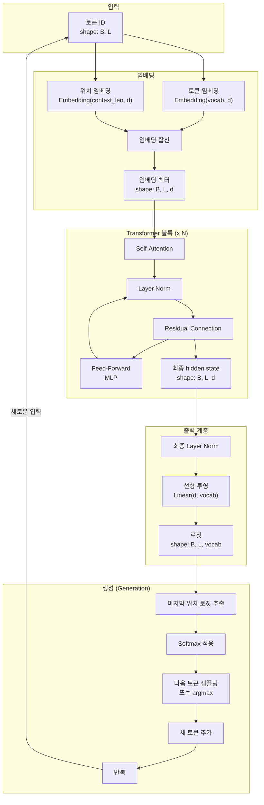

# Chapter 4: GPT 모델 구조 (GPT Model Architecture)

## 📚 개요
이 장에서는 완전한 GPT 모델을 구축합니다. 토큰화부터 로짓 생성까지, 그리고 텍스트 생성 루프까지의 전체 흐름을 학습합니다.

---

## 🏗️ 아키텍처 다이어그램



---

## 📖 상세 설명

### 1️⃣ **입력: 토큰 ID**

```python
input_ids: shape (B, L)  # (batch_size=4, sequence_length=256)
# [[15496, 11, 466, 345, ...],
#  [54321, 99, 23, 100, ...],
#  ...]
```

### 2️⃣ **임베딩 계층 (Embedding Layer)**

#### 🔹 **토큰 임베딩 (Token Embedding)**
```python
token_emb = nn.Embedding(vocab_size=50257, d_model=768)
x_emb = token_emb(input_ids)  # shape: (B, L, 768)
```

#### 🔹 **위치 임베딩 (Positional Embedding)**
```python
pos_emb = nn.Embedding(context_length=1024, d_model=768)
positions = torch.arange(L).unsqueeze(0)  # shape: (1, L)
pos_encoded = pos_emb(positions)  # shape: (1, L, 768)
```

#### 🔹 **임베딩 합산 (Embedding Fusion)**
```python
embeddings = x_emb + pos_encoded
# shape: (B, L, 768)
```

### 3️⃣ **Transformer 블록 (Transformer Block) - N 반복**

#### 🔹 **구조**
```python
class TransformerBlock(nn.Module):
    def __init__(self, d_model, num_heads, ff_hidden_dim):
        self.attention = MultiHeadAttention(d_model, num_heads)
        self.ffn = FeedForwardNetwork(d_model, ff_hidden_dim)
        self.norm1 = LayerNorm(d_model)
        self.norm2 = LayerNorm(d_model)
        
    def forward(self, x):
        # Self-Attention + Residual
        attn_out = self.attention(self.norm1(x))
        x = x + attn_out  # Residual connection
        
        # Feed-Forward + Residual
        ffn_out = self.ffn(self.norm2(x))
        x = x + ffn_out   # Residual connection
        return x
```

### 4️⃣ **출력 계층 (Output Layer)**

```python
output = final_norm(x)  # shape: (B, L, d_model)
lm_head = nn.Linear(d_model, vocab_size)
logits = lm_head(output)  # shape: (B, L, vocab_size)
```

### 5️⃣ **텍스트 생성 루프 (Generation Loop)**

```python
for _ in range(max_tokens):
    logits = model(input_ids)
    next_logits = logits[:, -1, :]
    probs = softmax(next_logits / temperature)
    next_token = torch.multinomial(probs, num_samples=1)
    input_ids = torch.cat([input_ids, next_token], dim=1)
```

---

## 🎯 핵심 하이퍼파라미터

| 파라미터 | 설명 | GPT-2 Small |
|---------|------|-------------|
| **d_model** | 임베딩/숨김 차원 | 768 |
| **num_heads** | Attention 헤드 수 | 12 |
| **num_blocks** | Transformer 블록 수 | 12 |
| **vocab_size** | 어휘 크기 | 50,257 |

---

## 🔗 다음 장과의 연결
- **Chapter 5**: 전체 모델을 데이터로 학습 (Pre-training)
- **Chapter 6~7**: 구체적 작업을 위해 미세 조정 (Fine-tuning)
