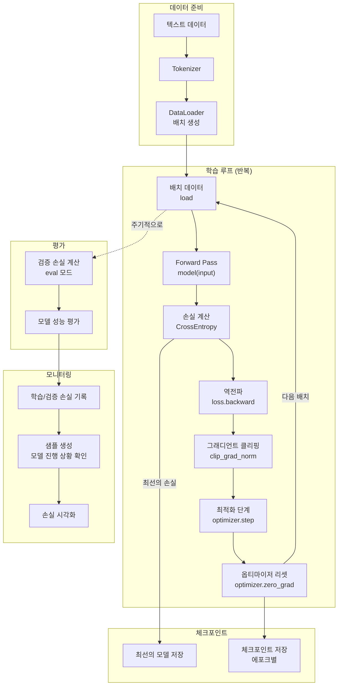

# Chapter 5: GPT 사전학습 루프 (Pre-training Loop)

## 📚 개요
이 장에서는 GPT 모델을 대규모 텍스트 데이터로 사전학습하는 전체 루프를 학습합니다.

---

## 🏗️ 아키텍처 다이어그램



---

## 📖 상세 설명

### 1️⃣ **데이터 준비 (Data Preparation)**

```python
from previous_chapters import create_dataloader_v1

train_loader = create_dataloader_v1(
    txt=train_text,
    batch_size=4,
    max_length=256,
    stride=128,
    shuffle=True
)
```

### 2️⃣ **학습 루프의 한 단계 (Single Training Step)**

#### 🔹 **Forward Pass (순전파)**
```python
model.train()
input_batch = input_batch.to(device)
target_batch = target_batch.to(device)

logits = model(input_batch)
# logits shape: (batch_size=4, seq_len=256, vocab_size=50257)
```

#### 🔹 **손실 계산 (Loss Calculation)**
```python
def calc_loss_batch(input_batch, target_batch, model, device):
    input_batch = input_batch.to(device)
    target_batch = target_batch.to(device)
    
    logits = model(input_batch)  # (B, L, vocab)
    
    logits_flat = logits.reshape(-1, logits.size(-1))
    targets_flat = target_batch.reshape(-1)
    
    loss = F.cross_entropy(logits_flat, targets_flat)
    return loss
```

#### 🔹 **역전파 (Backward Pass)**
```python
optimizer.zero_grad()
loss.backward()
torch.nn.utils.clip_grad_norm_(model.parameters(), 1.0)
optimizer.step()
```

### 3️⃣ **전체 에포크 (Full Epoch)**

```python
for epoch in range(num_epochs):
    model.train()
    train_loss_sum = 0
    
    for input_batch, target_batch in train_loader:
        loss = calc_loss_batch(input_batch, target_batch, model, device)
        optimizer.zero_grad()
        loss.backward()
        torch.nn.utils.clip_grad_norm_(model.parameters(), 1.0)
        optimizer.step()
        train_loss_sum += loss.item()
    
    # 검증
    model.eval()
    val_loss_sum = 0
    with torch.no_grad():
        for input_batch, target_batch in val_loader:
            loss = calc_loss_batch(input_batch, target_batch, model, device)
            val_loss_sum += loss.item()
```

### 4️⃣ **평가 (Evaluation)**

```python
def calc_loss_loader(data_loader, model, device):
    total_loss = 0
    model.eval()
    with torch.no_grad():
        for input_batch, target_batch in data_loader:
            loss = calc_loss_batch(input_batch, target_batch, model, device)
            total_loss += loss.item()
    return total_loss / len(data_loader)
```

---

## 🎯 핵심 포인트

| 단계 | 목적 | 수식 |
|------|------|------|
| **Forward** | 예측 | logits = model(x) |
| **Loss** | 오차 측정 | L = -Σ log(p_correct) |
| **Backward** | 그래디언트 | ∂L/∂θ (역전파) |
| **Clip** | 안정화 | grad ← grad * min(1, norm/max_norm) |
| **Step** | 업데이트 | θ ← θ - lr * ∂L/∂θ |

---

## 💡 중요한 설정

```python
optimizer = torch.optim.AdamW(model.parameters(), lr=5e-5)
scheduler = torch.optim.lr_scheduler.CosineAnnealingLR(optimizer, T_max=num_epochs)

max_grad_norm = 1.0

model.train()  # 훈련 중
model.eval()   # 평가 중
```

---

## 🔗 다음 장과의 연결
- **Chapter 6**: 사전학습 모델을 분류 작업으로 미세 조정
- **Chapter 7**: 지시 따르기 능력으로 미세 조정
