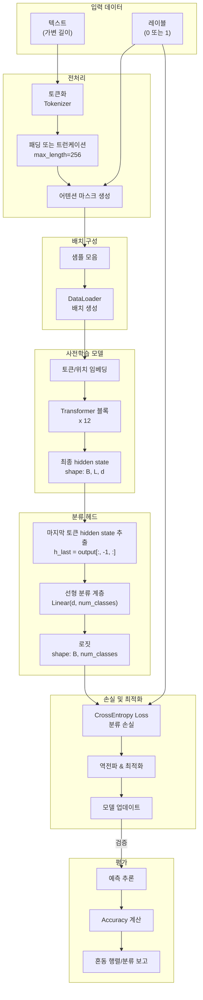

# Chapter 6: 텍스트 분류 미세조정 (Text Classification Fine-tuning)

## 📚 개요
이 장에서는 사전학습된 GPT 모델을 텍스트 분류 작업에 맞게 재사용하는 방법을 학습합니다.

---

## 🏗️ 아키텍처 다이어그램



---

## 📖 상세 설명

### 1️⃣ **전처리 (Preprocessing)**

#### 🔹 **토큰화 (Tokenization)**
```python
tokenizer = tiktoken.get_encoding("gpt2")
text = "Congratulations! You've won a free iPhone."
token_ids = tokenizer.encode(text, allowed_special={...})
```

#### 🔹 **패딩 및 트런케이션 (Padding & Truncation)**
```python
max_length = 256

if len(token_ids) > max_length:
    token_ids = token_ids[:max_length]
else:
    token_ids = token_ids + [0] * (max_length - len(token_ids))

assert len(token_ids) == max_length
```

#### 🔹 **어텐션 마스크 (Attention Mask)**
```python
attention_mask = [1 if token != 0 else 0 for token in token_ids]
# shape: (max_length,)
# 예: [1, 1, 1, 1, 1, 0, 0, 0, ...]
```

### 2️⃣ **배치 구성**

```python
class TextClassificationDataset(torch.utils.data.Dataset):
    def __getitem__(self, idx):
        # 토큰화, 패딩, 어텐션 마스크 준비
        return {
            'input_ids': torch.tensor(token_ids),
            'attention_mask': torch.tensor(attention_mask),
            'label': torch.tensor(label)
        }

train_loader = torch.utils.data.DataLoader(
    train_dataset, batch_size=32, shuffle=True
)
```

### 3️⃣ **분류 헤드**

#### 🔹 **마지막 토큰 추출**
```python
class ClassificationModel(nn.Module):
    def __init__(self, gpt_model, num_classes):
        super().__init__()
        self.gpt = gpt_model
        self.classifier = nn.Linear(gpt_model.cfg.emb_dim, num_classes)
    
    def forward(self, input_ids, attention_mask=None):
        last_hidden_states = self.gpt(input_ids)
        # shape: (B, L, d_model)
        
        last_token_hidden = last_hidden_states[:, -1, :]
        # shape: (B, d_model)
        
        logits = self.classifier(last_token_hidden)
        # shape: (B, num_classes)
        
        return logits
```

### 4️⃣ **손실 및 최적화**

```python
def calc_loss_batch(batch, model, device):
    input_ids = batch['input_ids'].to(device)
    attention_mask = batch['attention_mask'].to(device)
    labels = batch['label'].to(device)
    
    logits = model(input_ids, attention_mask)
    loss = F.cross_entropy(logits, labels)
    
    return loss
```

### 5️⃣ **평가**

```python
def evaluate(model, data_loader, device):
    model.eval()
    correct = 0
    total = 0
    
    with torch.no_grad():
        for batch in data_loader:
            input_ids = batch['input_ids'].to(device)
            labels = batch['label'].to(device)
            
            logits = model(input_ids)
            predictions = torch.argmax(logits, dim=1)
            
            correct += (predictions == labels).sum().item()
            total += labels.size(0)
    
    accuracy = correct / total
    return accuracy
```

---

## 🎯 핵심 포인트

| 단계 | 내용 | 중요도 |
|------|------|--------|
| **토큰화** | 텍스트 → ID | ⭐⭐⭐ |
| **패딩** | 고정 길이 통일 | ⭐⭐⭐ |
| **어텐션 마스크** | 패딩 무시 | ⭐⭐⭐ |
| **마지막 토큰** | 문장 표현 | ⭐⭐ |
| **분류 헤드** | 로짓 생성 | ⭐⭐⭐ |

---

## 🔗 다음 장과의 연결
- **Chapter 6-LoRA**: 같은 작업을 LoRA로 효율적으로 수행
- **Chapter 7**: 지시 따르기로 더 고급 미세조정
