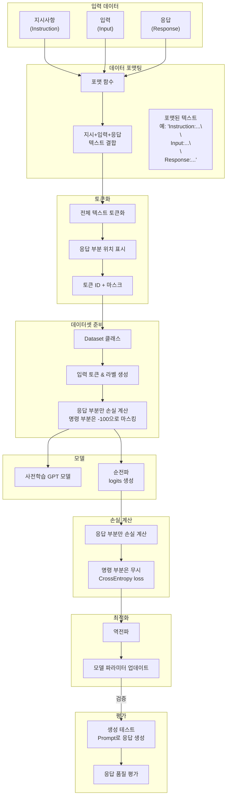

# Chapter 7: 지시 따르기 미세조정 (Instruction Following Fine-tuning)

## 📚 개요
이 장에서는 GPT 모델을 "지시 따르기" 능력에 맞게 미세조정하는 방법을 학습합니다.

---

## 🏗️ 아키텍처 다이어그램



---

## 📖 상세 설명

### 1️⃣ **입력 데이터 (Input Data)**

```json
{
  "instruction": "Classify the sentiment",
  "input": "The movie was great!",
  "response": "positive"
}
```

### 2️⃣ **데이터 포맷팅 (Data Formatting)**

#### 🔹 **포맷 함수**
```python
def format_input(example):
    instruction_text = (
        f"Instruction:\n{example['instruction']}"
    )
    input_text = (
        f"\n\nInput:\n{example['input']}"
        if example['input'] else ""
    )
    return instruction_text + input_text + "\n\nResponse:"

# 결과:
# "Instruction:
# Classify the sentiment
#
# Input:
# The movie was great!
#
# Response:"

# 최종 텍스트:
full_text = format_input(example) + example['response']
```

### 3️⃣ **토큰화 및 마스킹 (Tokenization & Masking)**

#### 🔹 **라벨 마스킹**
```python
def create_labels(token_ids, response_start_idx):
    labels = [-100] * len(token_ids)
    
    for i in range(response_start_idx, len(token_ids)):
        labels[i] = token_ids[i]
    
    return labels

# 예시
token_ids = [15496, 11, 4644, 1502, 11, ..., 1891, 7928]
#            명령 부분                           응답 부분
response_start_idx = 25

labels = [-100, -100, ..., -100, 1891, 7928]
#         ↑ 명령 부분 (손실 계산에서 무시)    ↑ 응답 부분 (손실 계산)
```

### 4️⃣ **손실 계산 (Loss Calculation)**

#### 🔹 **Masked Cross-Entropy Loss**
```python
def calc_loss(batch, model, device):
    input_ids = batch['input_ids'].to(device)
    labels = batch['labels'].to(device)
    
    logits = model(input_ids)  # (B, L, vocab_size)
    
    logits_flat = logits.view(-1, logits.size(-1))
    labels_flat = labels.view(-1)
    
    loss_fn = nn.CrossEntropyLoss(ignore_index=-100)
    loss = loss_fn(logits_flat, labels_flat)
    
    return loss

# ignore_index=-100은 다음을 의미:
# - labels[i] == -100인 위치의 손실 = 0
# - 명령 부분은 학습하지 않음
# - 응답 부분만 다음 토큰 예측 학습
```

### 5️⃣ **평가 및 생성 테스트 (Evaluation & Generation Testing)**

#### 🔹 **생성 함수**
```python
def generate_response(model, prompt, device, tokenizer, max_tokens=100):
    model.eval()
    
    prompt_text = format_input({
        "instruction": prompt,
        "input": ""
    }) + "\n"
    
    prompt_tokens = tokenizer.encode(prompt_text)
    input_ids = torch.tensor(prompt_tokens).unsqueeze(0).to(device)
    
    with torch.no_grad():
        for _ in range(max_tokens):
            logits = model(input_ids)
            next_logits = logits[0, -1, :]
            
            probs = F.softmax(next_logits / 0.7, dim=0)
            next_token = torch.multinomial(probs, num_samples=1)
            
            input_ids = torch.cat([
                input_ids,
                next_token.unsqueeze(0).unsqueeze(0)
            ], dim=1)
            
            if next_token.item() == tokenizer.encode("<|endoftext|>")[0]:
                break
    
    result = tokenizer.decode(input_ids[0].tolist())
    return result

# 테스트
prompt = "Classify the sentiment of: The weather is beautiful today"
response = generate_response(model, prompt, device, tokenizer)
```

---

## 📊 데이터 흐름 요약

```
지시 데이터
    ↓
포맷팅 (Instruction + Input + Response)
    ↓
토큰화 (명령 부분 + 응답 부분)
    ↓
라벨 생성 (명령: -100, 응답: 토큰 ID)
    ↓
배치 구성 (패딩 포함)
    ↓
모델 순전파 (logits 생성)
    ↓
손실 계산 (응답 부분만)
    ↓
역전파 & 최적화
    ↓
생성 테스트 (지시 따르기 평가)
```

---

## 🎯 핵심 포인트

| 개념 | 설명 | 중요도 |
|------|------|--------|
| **포맷팅** | 명령과 응답을 구조화된 텍스트로 결합 | ⭐⭐⭐ |
| **라벨 마스킹** | 명령 부분은 -100으로 표시, 응답만 학습 | ⭐⭐⭐ |
| **ignore_index=-100** | CrossEntropyLoss에서 -100 위치 무시 | ⭐⭐⭐ |
| **응답 부분만 최적화** | 모델이 응답만 올바르게 생성하도록 유도 | ⭐⭐ |

---

## 💡 실무 팁

### 데이터 포맷팅 베스트 프랙티스

```python
# ❌ 좋지 않은 예시
"Classify sentiment\nThe movie was great!\npositive"

# ✅ 좋은 예시
"Instruction: Classify sentiment\n\nInput: The movie was great!\n\nResponse: positive"
```

### 응답 토큰만 학습하는 이유

```
명령 부분 학습:
- 같은 명령을 여러 번 반복 학습
- 낭비적인 학습

응답 부분만 학습:
- 다양한 응답 방식 학습
- 효율적인 학습
- 지시 따르기 능력 향상
```

---

## 🔗 관련 주제
- **Chapter 5 (DPO)**: 더 나은 지시 따르기를 위한 DPO 기법
- **Chapter 6-LoRA**: LoRA로 효율적인 미세조정
