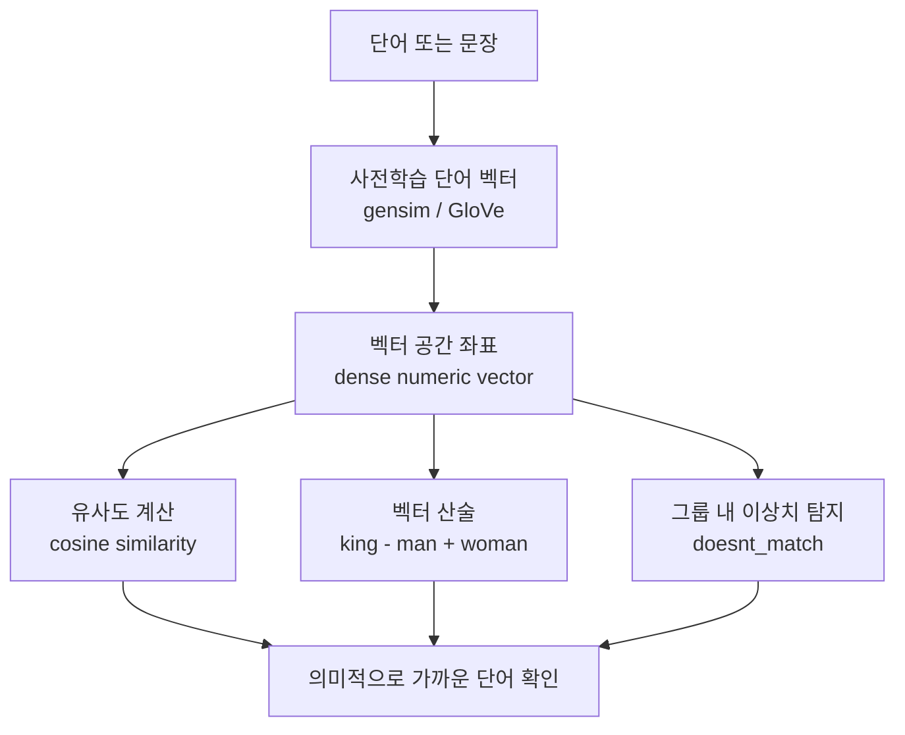
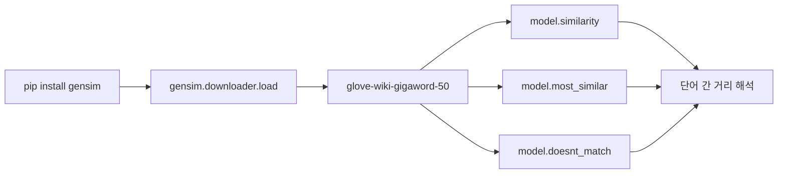
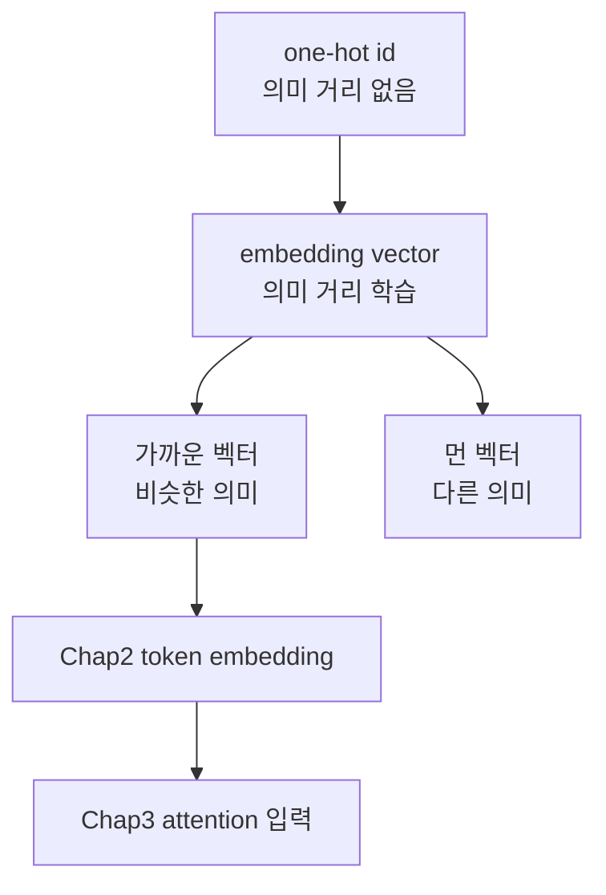

# Chapter 1 Vector Space Diagrams

- 관련 문서: [../Chapter_1_Exercise_Vector_Space.md](../Chapter_1_Exercise_Vector_Space.md)
- 관련 노트북: [../../Chapter_1_Exercise_Vector Space.ipynb](../../Chapter_1_Exercise_Vector%20Space.ipynb)

## 전체 흐름

## 실습 코드 흐름

## 개념 연결

## 체크포인트

