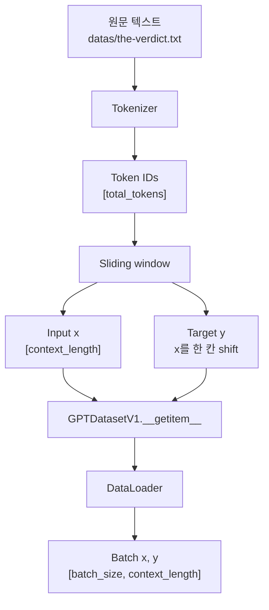
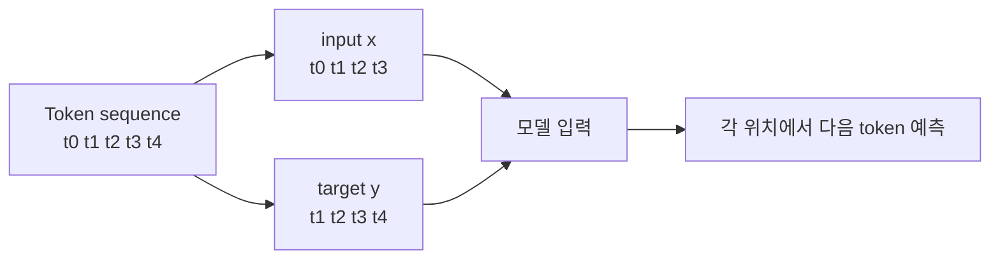
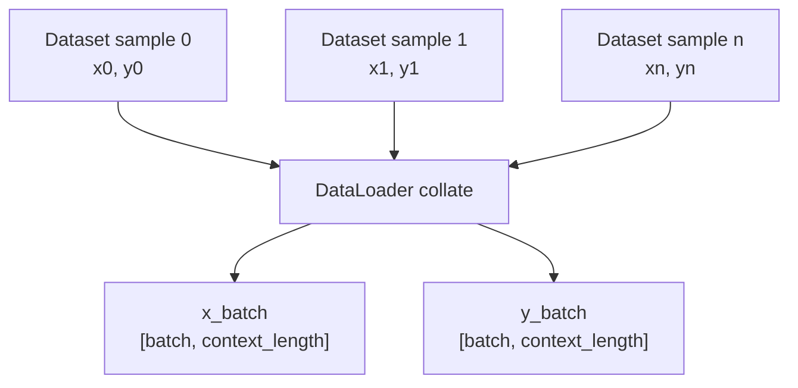
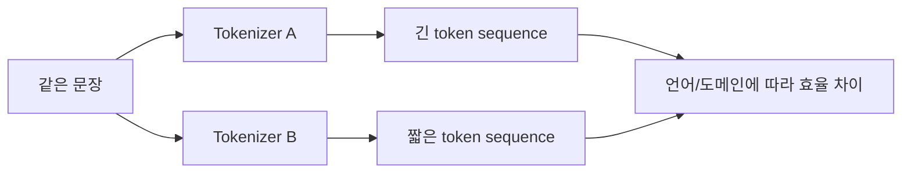

# Chapter 2 Dataset Diagrams

- 관련 문서: [../Chapter_2_Exercise_Dataset.md](../Chapter_2_Exercise_Dataset.md)
- 관련 노트북: [../../Chapter_2_Exercise_Dataset.ipynb](../../Chapter_2_Exercise_Dataset.ipynb)

## 전체 흐름

## Next-Token Dataset

## DataLoader 역할

## Tokenizer 비교

