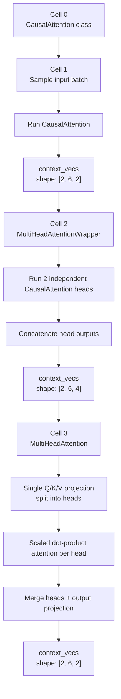
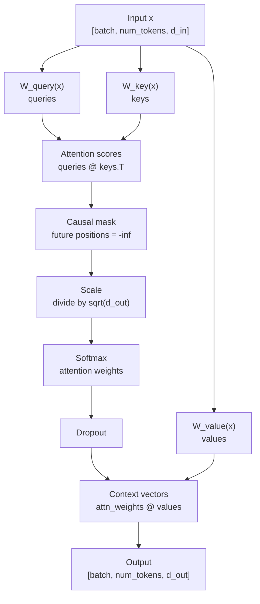
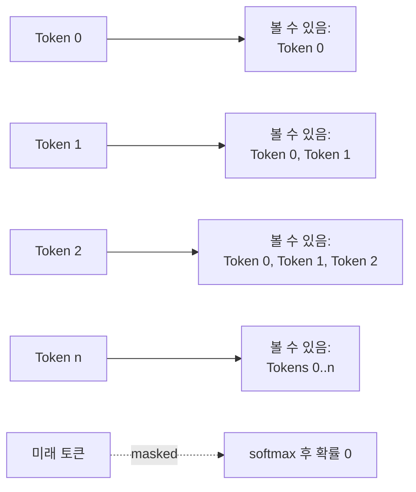
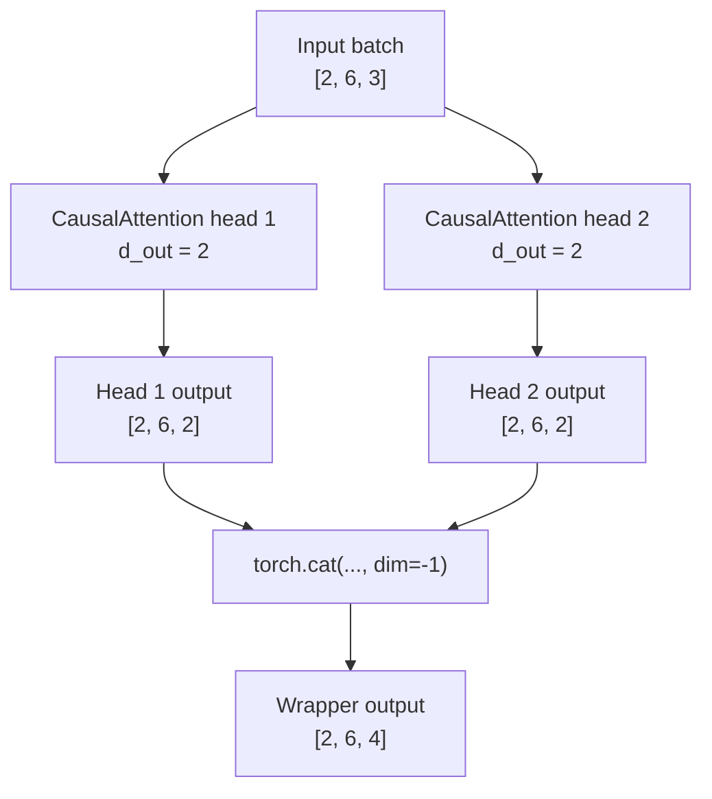
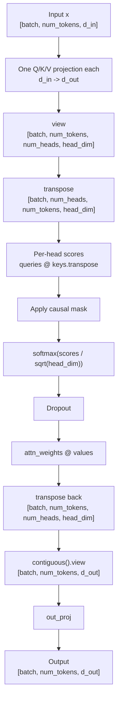
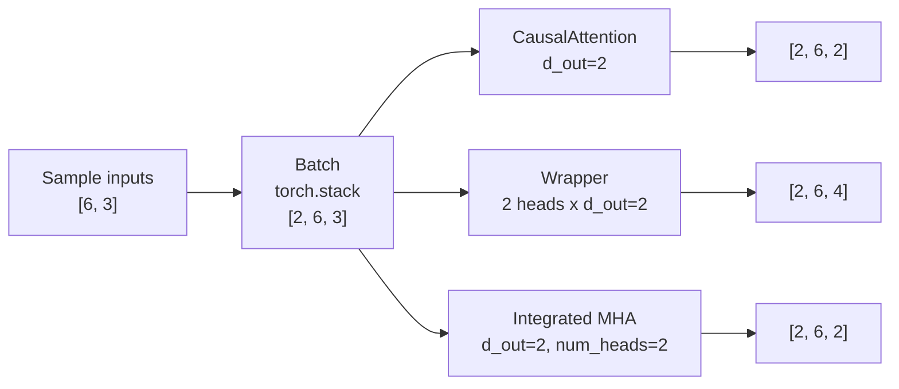

# Chapter 3 Attention Diagrams

- 관련 문서: [../Chapter_3_Excercise_Attention.md](../Chapter_3_Excercise_Attention.md)
- 관련 노트북: [../../Chapter_3_Excercise_Attention.ipynb](../../Chapter_3_Excercise_Attention.ipynb)

## Notebook Flow

## CausalAttention

## Causal Mask

## MultiHeadAttentionWrapper

## MultiHeadAttention

## Shape Summary

