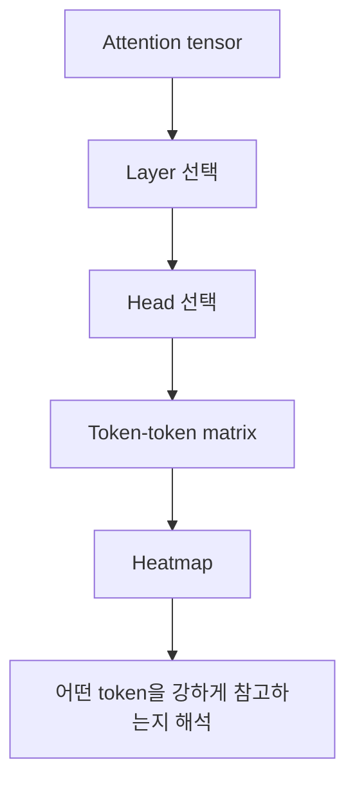
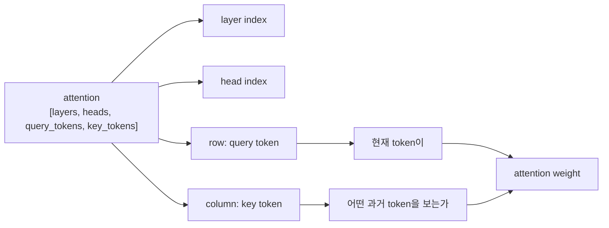
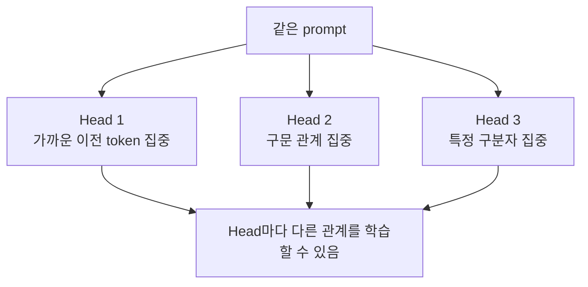
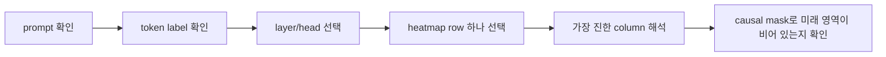

# Chapter 3 Multi-Head Attention Visualization Diagrams

- 관련 문서: [../Chapter_3_Excercise_Viz_Multi_head_attention.md](../Chapter_3_Excercise_Viz_Multi_head_attention.md)
- 관련 노트북: [../../Chapter_3_Excercise_Viz_Multi_head_attention.ipynb](../../Chapter_3_Excercise_Viz_Multi_head_attention.ipynb)

## 시각화 목표

## 축 해석

## Head별 패턴 비교

## 읽는 순서

