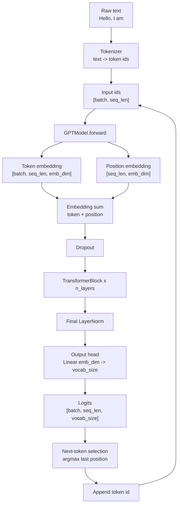
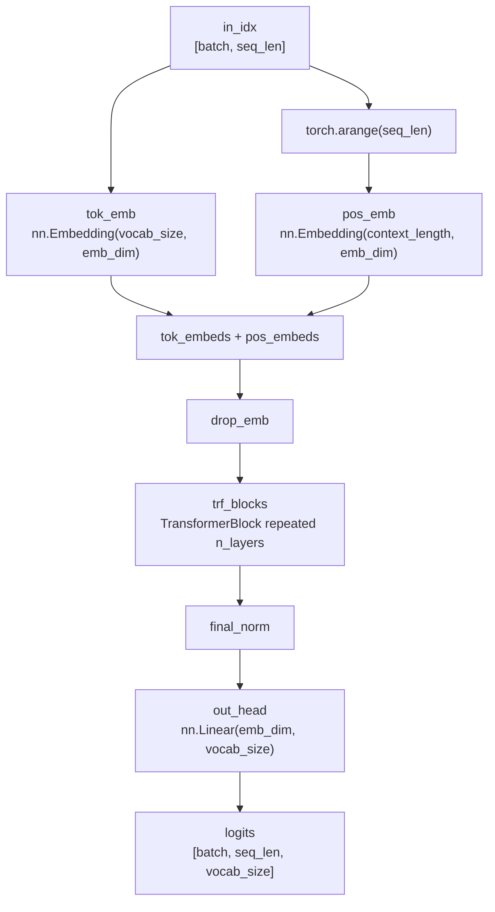
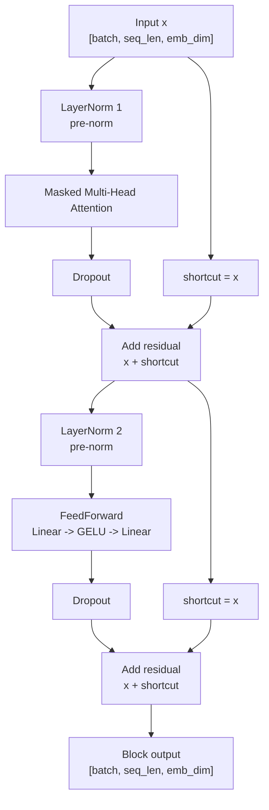
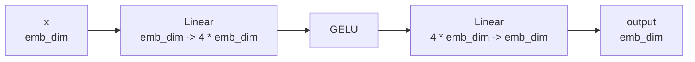
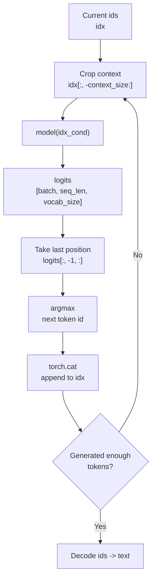
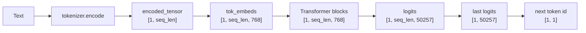

# Chapter 4 GPT Diagrams

- 관련 문서: [../Chapter_4_Excercise_GPT.md](../Chapter_4_Excercise_GPT.md)
- 관련 노트북: [../../Chapter_4_Excercise_GPT.ipynb](../../Chapter_4_Excercise_GPT.ipynb)

## Chapter 4 전체 구조

## GPTModel 내부

## TransformerBlock 구조

## FeedForward 구조

FeedForward는 토큰끼리 섞는 역할이 아니라, attention이 만든 각 토큰의 표현을 개별적으로 더 복잡하게 가공하는 역할입니다. 보통 내부 차원을 4배로 키웠다가 다시 줄입니다.

## Text Generation Loop

## Shape Summary

