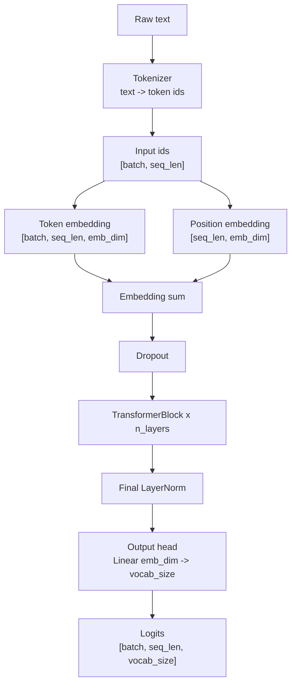
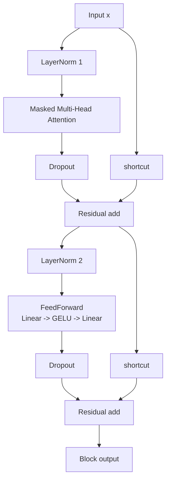
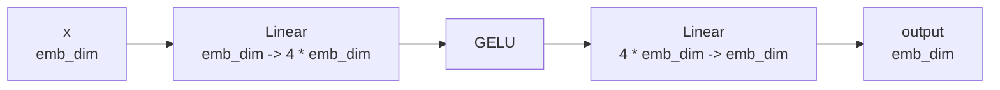
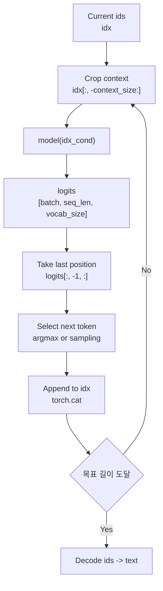
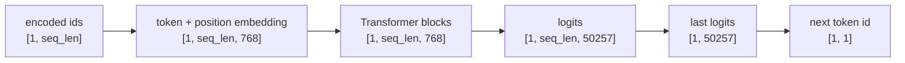

# Chapter 4 GPT Diagrams

- 관련 문서: [../Chapter_4_Excercise_GPT.md](../Chapter_4_Excercise_GPT.md)
- 관련 노트북: [../../Chapter_4_Excercise_GPT.ipynb](../../Chapter_4_Excercise_GPT.ipynb)

## 전체 구조

## TransformerBlock

## FeedForward

## Text Generation Loop

## Shape Summary

