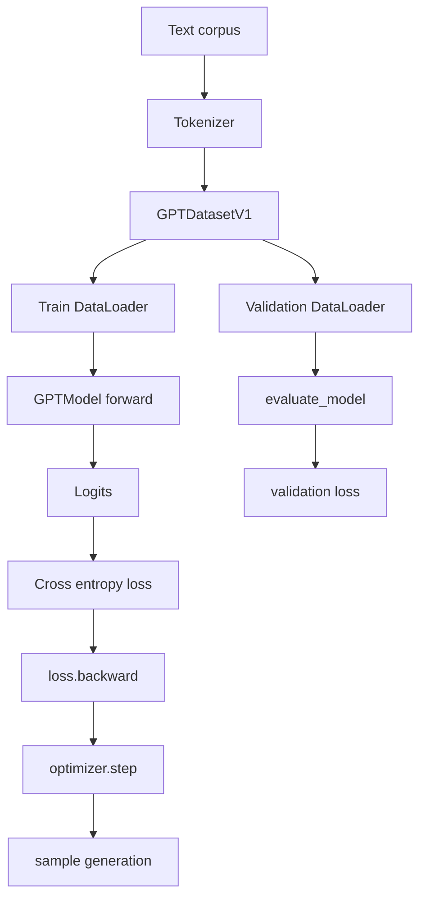
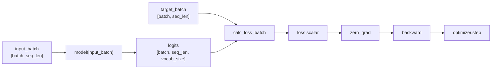
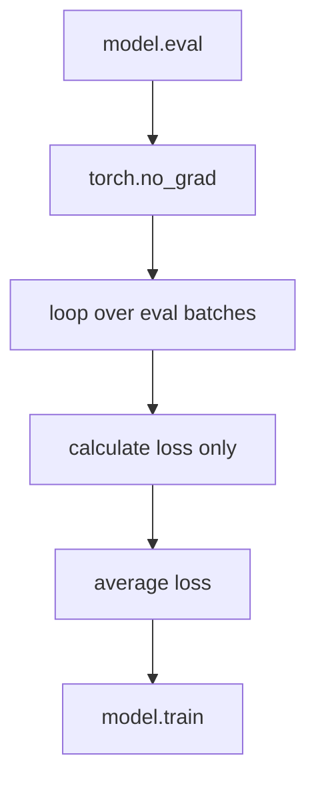
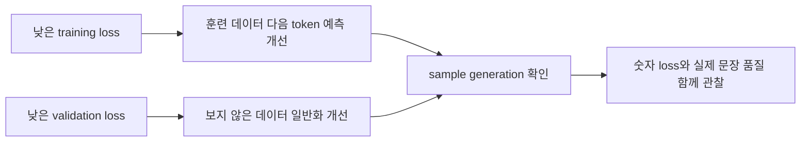

# Chapter 5 Pretraining Diagrams

- 관련 문서: [../Chapter_5_Excercise_Pretraining.md](../Chapter_5_Excercise_Pretraining.md)
- 관련 노트북: [../../Chapter_5_Excercise_Pretraining.ipynb](../../Chapter_5_Excercise_Pretraining.ipynb)

## 전체 흐름

## Training Step

## Evaluation Step

## Loss와 생성의 관계

