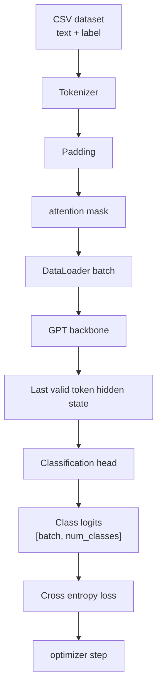
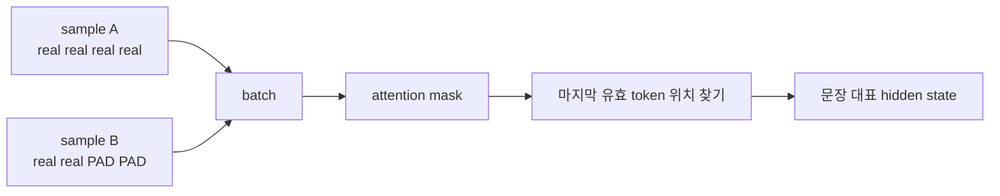
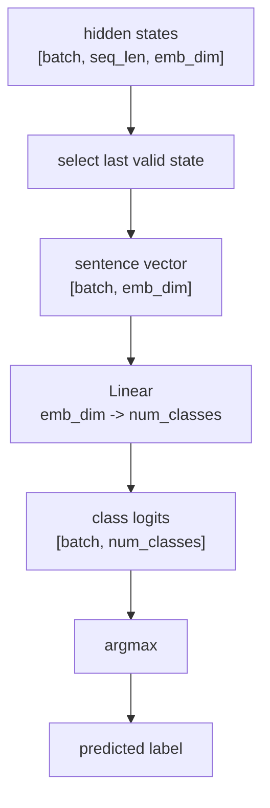
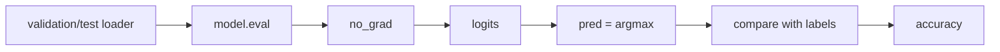

# Chapter 6 Classification Fine-Tuning Diagrams

- 관련 문서: [../Chapter_6_Excercise_Finetuning_Classification.md](../Chapter_6_Excercise_Finetuning_Classification.md)
- 관련 노트북: [../../Chapter_6_Excercise_Finetuning_Classification.ipynb](../../Chapter_6_Excercise_Finetuning_Classification.ipynb)

## 전체 흐름

## Padding과 마지막 유효 Token

## 분류 Head

## 평가 흐름

