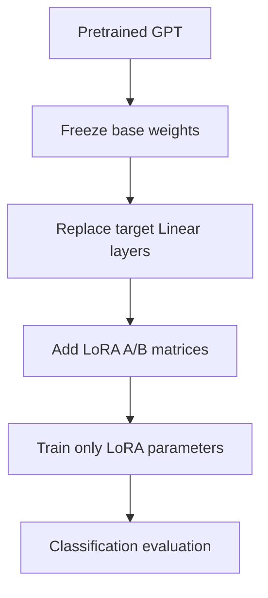
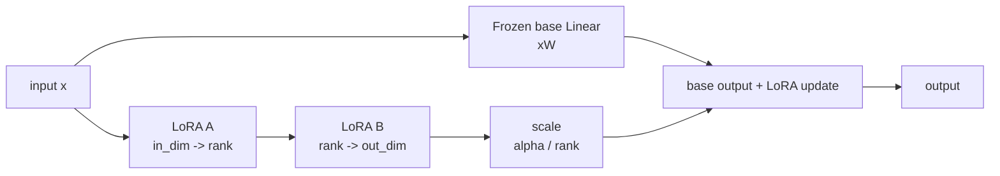
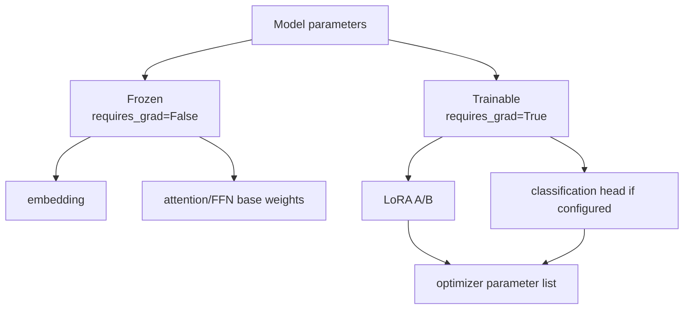
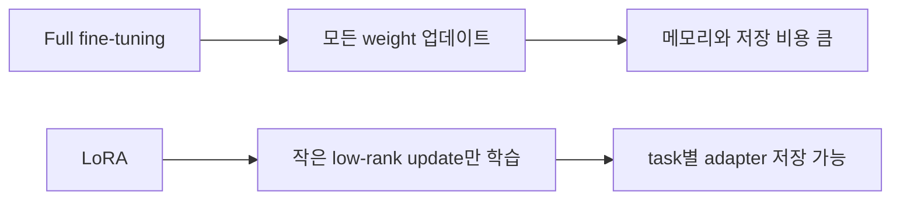

# Chapter 6 LoRA Fine-Tuning Diagrams

- 관련 문서: [../Chapter_6_Excercise_Finetuning_Classification_LoRA.md](../Chapter_6_Excercise_Finetuning_Classification_LoRA.md)
- 관련 노트북: [../../Chapter_6_Excercise_Finetuning_Classification_LoRA.ipynb](../../Chapter_6_Excercise_Finetuning_Classification_LoRA.ipynb)

## 전체 흐름

## LoRA Linear

## 학습 가능한 파라미터

## Full Fine-Tuning vs LoRA

