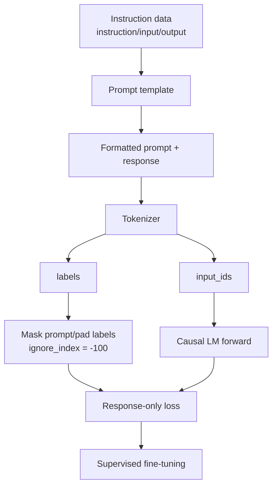
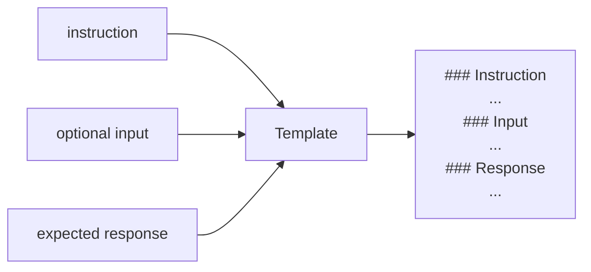
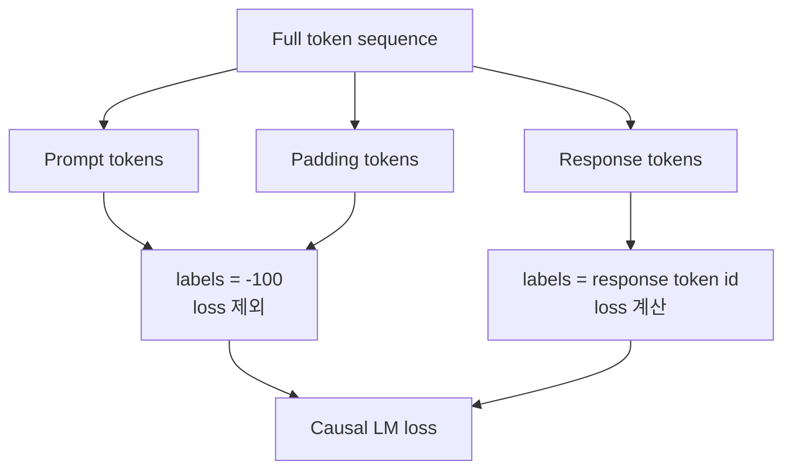
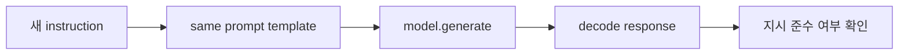

# Chapter 7 Instruction Fine-Tuning Diagrams

- 관련 문서: [../Chapter_7_Exercise_Follow_Instructions.md](../Chapter_7_Exercise_Follow_Instructions.md)
- 관련 노트북: [../../Chapter_7_Exercise_Follow_Instructions.ipynb](../../Chapter_7_Exercise_Follow_Instructions.ipynb)

## 전체 흐름

## Prompt Formatting

## Label Masking

## 생성 평가

