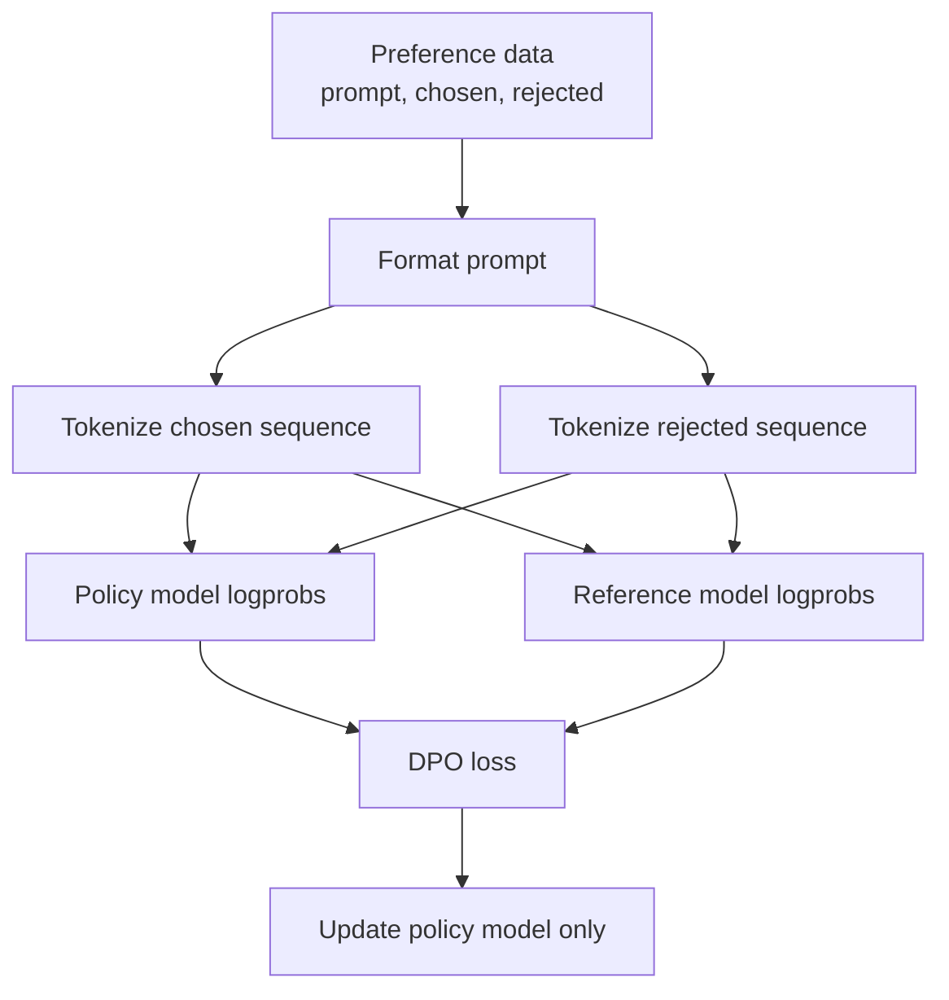
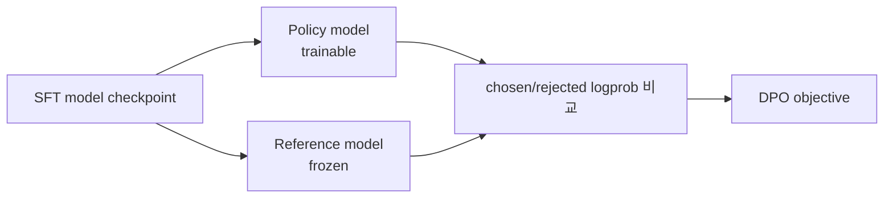
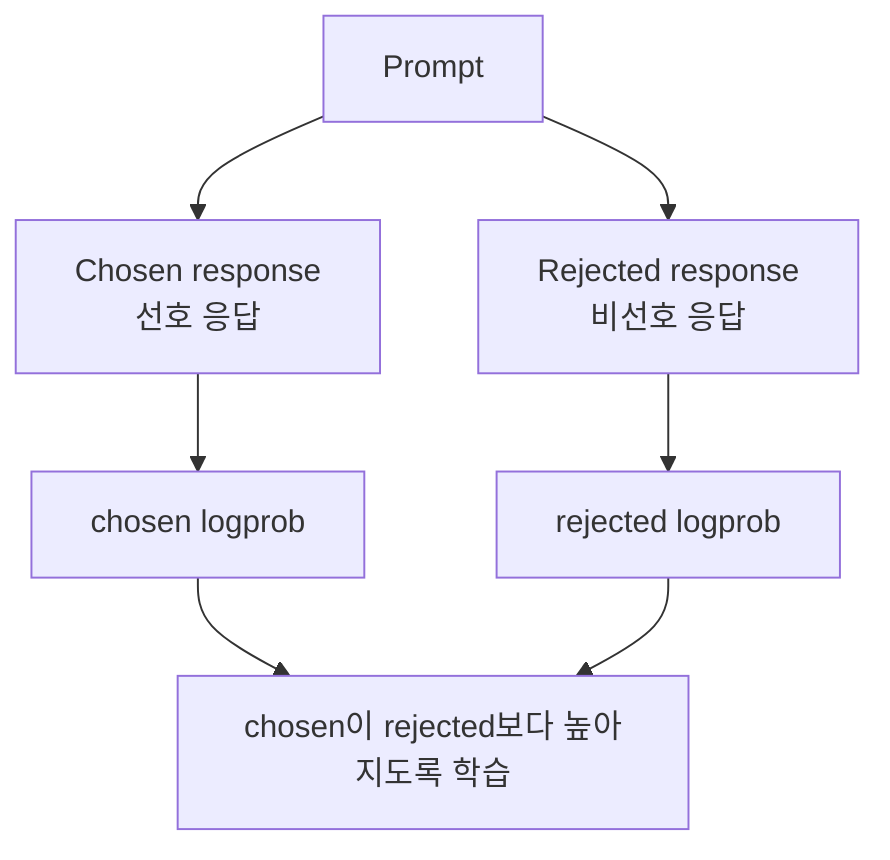
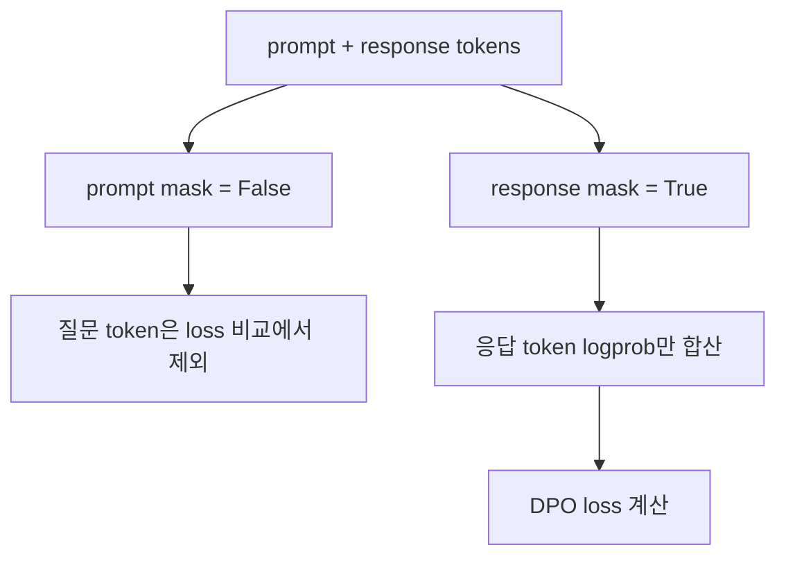
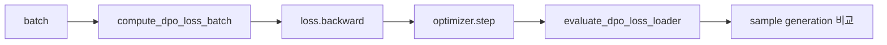

# Chapter 7 DPO Diagrams

- 관련 문서: [../Chapter_7_Exercise_Follow_Instructions_dpo.md](../Chapter_7_Exercise_Follow_Instructions_dpo.md)
- 관련 노트북: [../../Chapter_7_Exercise_Follow_Instructions_dpo.ipynb](../../Chapter_7_Exercise_Follow_Instructions_dpo.ipynb)

## 전체 흐름

## Policy와 Reference

## Chosen / Rejected Pair

## Masking과 Log Probability

## 학습 루프

