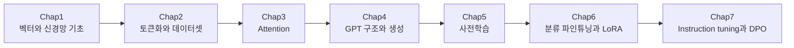

# LLM 강의 노트

이 폴더는 `pdf/AI-Application-Specialist-LLM-20260420_part1.pdf`와
`pdf/AI-Application-Specialist-LLM-20260420_part2.pdf`를 참고해,
실습 노트북 `Chapter_1`부터 `Chapter_7`까지를 강의용으로 다시 정리한 문서입니다.

원 PDF의 슬라이드 순서를 그대로 베낀 자료가 아니라, 수강자가 실습 코드를 따라가며
왜 이 개념이 필요한지 이해할 수 있도록 재구성했습니다.

## 전체 흐름

## 파일 목록

| 장 | 강의 노트 | 핵심 질문 |
|---|---|---|
| Chap1 | [chap1_vector_space_math.md](chap1_vector_space_math.md) | 텍스트를 왜 벡터로 바꾸며, 신경망 계산은 어떤 수학으로 움직이는가? |
| Chap2 | [chap2_tokenizer_dataset.md](chap2_tokenizer_dataset.md) | 문장을 모델이 학습할 수 있는 토큰 시퀀스로 어떻게 바꾸는가? |
| Chap3 | [chap3_attention.md](chap3_attention.md) | Attention은 문맥을 어떻게 계산하는가? |
| Chap4 | [chap4_gpt_model.md](chap4_gpt_model.md) | GPT 블록은 어떤 부품으로 구성되고, 다음 토큰은 어떻게 생성되는가? |
| Chap5 | [chap5_pretraining.md](chap5_pretraining.md) | 언어 모델은 대규모 텍스트에서 무엇을 학습하는가? |
| Chap6 | [chap6_finetuning_lora.md](chap6_finetuning_lora.md) | 사전학습 모델을 분류 문제에 맞추고, LoRA로 효율화하는 방법은 무엇인가? |
| Chap7 | [chap7_instruction_dpo.md](chap7_instruction_dpo.md) | 모델이 지시를 따르게 만들고 선호도를 반영하려면 어떻게 학습시키는가? |

## 읽는 순서

처음 학습한다면 Chap1부터 순서대로 읽는 것이 좋습니다. 이미 Python에는 익숙하지만
PyTorch와 Transformer가 낯설다면, 각 장의 `코드 관점`과 `shape 체크포인트`를 특히 집중해서 보면 됩니다.

# FAQ

자주 묻는 질문은 [LLM Hands-on FAQ](../docs/FAQ.md)에 정리되어 있습니다. 각 강의 노트의 끝에도 관련 FAQ 링크가 연결되어 있습니다.
