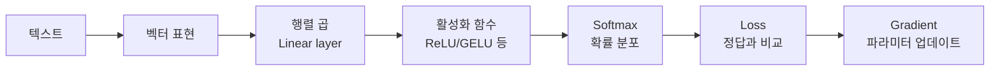

# Chap1. 벡터 공간과 신경망 수학 기초

참고 자료: `../pdf/AI-Application-Specialist-LLM-20260420_part1.pdf` 중 슬라이드 30-57 전후

## 이 장을 왜 배우는가

LLM은 문장을 직접 이해하지 않습니다. 문장을 숫자 ID로 바꾸고, 다시 벡터로 바꾼 뒤,
그 벡터들을 행렬 곱과 비선형 함수로 계속 변환합니다. 그래서 LLM을 이해하려면
먼저 "텍스트가 벡터 공간에서 계산된다"는 관점을 잡아야 합니다.

이 장의 목적은 고급 수학을 증명하는 것이 아니라, 이후 챕터에서 나오는
embedding, linear layer, softmax, loss, gradient descent를 읽을 수 있는 최소한의 언어를 만드는 것입니다.

## 한눈에 보는 흐름



## 학습 목표

- 스칼라, 벡터, 행렬, 텐서의 차이를 설명할 수 있다.
- 내적과 cosine similarity가 "두 벡터가 얼마나 비슷한가"를 재는 방법임을 이해한다.
- linear layer가 입력 벡터를 다른 차원의 벡터로 바꾸는 행렬 변환임을 이해한다.
- activation function이 없으면 신경망이 깊어져도 선형 변환의 반복에 머문다는 점을 이해한다.
- softmax가 점수(logit)를 확률처럼 해석 가능한 값으로 바꾼다는 것을 이해한다.
- cross entropy loss가 언어 모델 학습에서 왜 쓰이는지 설명할 수 있다.

## 1. 벡터는 "의미를 담은 좌표"다

벡터는 숫자들의 묶음입니다. 예를 들어 단어 하나를 `[0.2, -1.1, 0.7]` 같은 숫자 목록으로
표현할 수 있습니다. 중요한 점은 각 숫자를 사람이 직접 해석하기 어렵더라도,
모델은 이 좌표를 이용해 단어 사이의 관계를 계산한다는 것입니다.

예를 들어 비슷한 의미의 단어들은 벡터 공간에서 가까운 위치에 놓이도록 학습될 수 있습니다.
이후 챕터에서 나오는 token embedding은 바로 이 아이디어를 사용합니다.

### 용어 정리

| 용어 | 예시 | 의미 |
|---|---|---|
| Scalar | `3.14` | 숫자 하나 |
| Vector | `[1.2, -0.4, 0.9]` | 숫자 여러 개로 된 1차원 배열 |
| Matrix | `[[1, 2], [3, 4]]` | 행과 열을 가진 2차원 배열 |
| Tensor | `[batch, token, dim]` | 차원이 더 일반화된 배열 |

PyTorch에서 대부분의 데이터는 `torch.Tensor`입니다. 벡터와 행렬도 Tensor의 특별한 경우라고 보면 됩니다.

## 2. 내적은 두 벡터의 방향성과 크기를 섞어 재는 계산이다

두 벡터 `a`, `b`의 내적은 같은 위치의 숫자를 곱해서 모두 더한 값입니다.

```text
a = [1, 2, 3]
b = [4, 5, 6]

dot(a, b) = 1*4 + 2*5 + 3*6 = 32
```

Attention에서 query와 key의 유사도를 계산할 때도 내적이 핵심으로 등장합니다.
즉, Chap1의 내적은 Chap3 Attention으로 바로 이어집니다.

## 3. Cosine similarity는 "방향이 얼마나 같은가"를 본다

내적은 벡터의 크기에도 영향을 받습니다. 반면 cosine similarity는 두 벡터가 이루는 각도에 집중합니다.

- `1`에 가까움: 거의 같은 방향
- `0`에 가까움: 관련이 약함
- `-1`에 가까움: 반대 방향

텍스트 임베딩 검색에서 "질문과 문서가 얼마나 비슷한가"를 잴 때 cosine similarity가 자주 쓰입니다.

## 4. Matrix multiplication은 여러 선형 조합을 한 번에 계산한다

신경망에서 가장 자주 보는 연산은 다음 형태입니다.

```text
y = xW + b
```

- `x`: 입력 벡터 또는 입력 행렬
- `W`: 학습되는 weight matrix
- `b`: bias
- `y`: 변환된 출력

PyTorch에서는 보통 `nn.Linear(in_features, out_features)`가 이 역할을 합니다.
LLM 내부의 Q, K, V projection, FFN layer, classification head 모두 이 계열의 계산입니다.

### Shape 예시

```text
x: [batch_size, input_dim]
W: [input_dim, output_dim]
y: [batch_size, output_dim]
```

만약 `input_dim=768`, `output_dim=3072`라면, 하나의 토큰 벡터를 더 큰 은닉 표현으로 확장하는 계산입니다.
Transformer의 FFN에서 흔히 이런 확장-축소 구조가 등장합니다.

## 5. Activation function은 선형 계산만으로 부족한 표현력을 보완한다

Linear layer만 여러 번 쌓으면 결국 하나의 큰 linear layer와 같은 역할을 하게 됩니다.
중간에 activation function을 넣어야 모델이 곡선적이고 복잡한 패턴을 표현할 수 있습니다.

대표적인 activation:

| 함수 | 직관 |
|---|---|
| Sigmoid | 값을 0과 1 사이로 압축 |
| ReLU | 음수는 0, 양수는 그대로 통과 |
| GELU | 작은 값은 부드럽게 줄이고 큰 값은 통과시키는 형태 |

GPT 계열에서는 FFN 내부에서 GELU 계열 활성화가 자주 사용됩니다.

## 6. Softmax는 점수를 확률 분포처럼 바꾼다

모델은 처음부터 확률을 내놓지 않습니다. 보통 `logits`라는 원시 점수를 출력합니다.
softmax는 이 점수들을 양수로 바꾸고, 전체 합이 1이 되도록 정규화합니다.

```text
logits = [2.0, 1.0, 0.1]
softmax(logits) = [0.66, 0.24, 0.10]  # 예시
```

언어 모델에서는 vocabulary의 모든 토큰에 대해 점수를 만든 뒤,
softmax를 통해 "다음 토큰일 확률"로 해석합니다.

## 7. Cross entropy는 정답 토큰의 확률을 높이도록 만든다

언어 모델이 다음 토큰을 예측할 때, 정답 토큰의 확률이 높으면 loss가 작아지고,
정답 토큰의 확률이 낮으면 loss가 커집니다. Cross entropy는 이 목적에 잘 맞는 loss입니다.

직관적으로는 다음과 같습니다.

```text
모델 예측: "apple" 확률 0.80
정답: "apple"
=> loss 작음

모델 예측: "apple" 확률 0.05
정답: "apple"
=> loss 큼
```

Chap5의 사전학습에서는 이 loss를 대량의 텍스트에 대해 반복적으로 줄입니다.

## 8. Backpropagation은 "어느 파라미터를 어떻게 고칠지" 계산한다

학습은 단순히 틀렸다는 사실만으로는 되지 않습니다. 어떤 weight가 loss에 얼마나 영향을 줬는지 알아야 합니다.
Backpropagation은 chain rule을 이용해 loss에서 각 파라미터까지의 gradient를 계산합니다.

PyTorch에서는 대부분 다음 흐름으로 동작합니다.

```python
loss = criterion(outputs, targets)
loss.backward()
optimizer.step()
optimizer.zero_grad()
```

- `loss.backward()`: gradient 계산
- `optimizer.step()`: 파라미터 업데이트
- `optimizer.zero_grad()`: 이전 gradient 초기화

## 코드 관점에서 꼭 볼 것

Chap1 실습 코드에서는 다음을 확인하면 됩니다.

- Tensor의 shape이 연산 전후로 어떻게 바뀌는가?
- `torch.matmul`, `@`, `nn.Linear`가 어떤 행렬 곱을 하는가?
- softmax 적용 전 값과 적용 후 값이 어떻게 달라지는가?
- loss는 scalar 하나로 줄어드는가?
- `backward()` 이후 파라미터에 `.grad`가 생기는가?

## 자주 헷갈리는 지점

1. 벡터의 각 차원이 사람이 붙인 명확한 의미를 가진다고 생각하기 쉽습니다. 실제로는 학습 과정에서 유용한 방향들이 만들어지는 경우가 많습니다.
2. softmax 결과는 확률처럼 해석하지만, 모델이 항상 사실을 알고 있다는 뜻은 아닙니다. 가능한 토큰들 사이의 상대 점수입니다.
3. loss가 낮아진다는 것은 훈련 데이터의 다음 토큰 예측을 더 잘한다는 뜻이지, 모든 질문에 더 잘 답한다는 뜻은 아닙니다.
4. gradient는 정답 자체가 아니라, loss를 줄이는 방향에 대한 수치 정보입니다.

## 수업 중 질문

- 단어를 one-hot vector로만 표현하면 어떤 한계가 있을까?
- cosine similarity와 dot product는 언제 비슷하고 언제 달라질까?
- softmax를 적용하면 가장 큰 logit의 순위는 바뀔까?
- `loss.backward()`를 호출하지 않으면 optimizer는 무엇을 기준으로 업데이트할까?

## 이 장을 배우고 나면

이후 장에서 등장하는 embedding, attention score, linear projection, FFN, cross entropy loss를
"마법 같은 딥러닝 용어"가 아니라 벡터와 행렬의 계산 흐름으로 읽을 수 있습니다.

