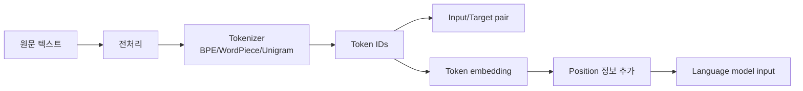

# Chap2. 토큰화, 데이터셋, 임베딩

참고 자료: `../pdf/AI-Application-Specialist-LLM-20260420_part1.pdf` 중 슬라이드 69-94 전후

## 이 장을 왜 배우는가

LLM은 문자열을 직접 입력받지 않습니다. 문장을 토큰 ID의 배열로 바꾸고,
그 ID를 embedding vector로 변환한 뒤 모델에 넣습니다. 따라서 좋은 언어 모델 실습은
모델 구조를 보기 전에 "입력이 어떤 모양으로 만들어지는가"를 이해하는 것에서 시작합니다.

이 장은 tokenizer, special token, sliding window dataset, positional encoding을 다룹니다.

## 한눈에 보는 흐름



## 학습 목표

- 텍스트가 token ID로 변환되는 과정을 설명할 수 있다.
- BPE, WordPiece, Unigram이 왜 subword 단위 토큰화를 사용하는지 이해한다.
- special token의 역할을 설명할 수 있다.
- language model 학습에서 input과 target이 한 칸씩 밀린 관계임을 이해한다.
- token embedding과 positional encoding이 각각 무엇을 담당하는지 구분할 수 있다.

## 1. 전처리는 모델 입력을 안정적으로 만들기 위한 단계다

전처리는 불필요한 문자를 제거하거나, 줄바꿈/공백을 정리하거나, 학습 목적에 맞게 텍스트를 나누는 과정입니다.
다만 LLM에서는 전처리를 과하게 하면 원래 텍스트의 패턴을 잃을 수 있습니다.

예를 들어 문장부호, 대소문자, 줄바꿈은 모두 의미 있는 신호가 될 수 있습니다.
따라서 "깨끗하게 만드는 것"보다 "모델이 일관되게 볼 수 있게 만드는 것"이 핵심입니다.

## 2. Tokenizer는 문자열을 정수 ID로 바꾼다

Tokenizer는 텍스트를 모델의 vocabulary에 있는 토큰들로 분해하고, 각 토큰을 정수 ID로 바꿉니다.

```text
"I love LLMs"
=> ["I", " love", " L", "LM", "s"]  # 예시
=> [40, 1842, 445, 11231, 82]
```

토큰은 반드시 단어와 같지 않습니다. 영어에서는 공백이 붙은 토큰이 나오기도 하고,
한국어처럼 형태 변화가 많은 언어에서는 subword가 특히 중요합니다.

## 3. Subword tokenization이 필요한 이유

단어 단위 vocabulary를 만들면 희귀 단어와 신조어를 처리하기 어렵습니다.
문자 단위로 만들면 모든 단어를 표현할 수 있지만 sequence가 너무 길어집니다.
Subword 방식은 그 중간 지점입니다.

| 방식 | 아이디어 | 장점 | 단점 |
|---|---|---|---|
| BPE | 자주 함께 나오는 문자/조각을 병합 | 구현과 이해가 비교적 직관적 | 병합 규칙에 의존 |
| WordPiece | likelihood를 기준으로 subword 선택 | BERT 계열에서 널리 사용 | 학습 방식이 다소 복잡 |
| Unigram | 가능한 subword 후보에서 확률적으로 선택 | 다양한 분해 가능 | 초기 vocabulary 설계가 중요 |

핵심은 "모르는 단어도 아는 조각들의 조합으로 표현하자"입니다.

## 4. Special token은 텍스트 외의 제어 정보를 표현한다

모델 입력에는 순수한 텍스트만 들어가지 않습니다. 학습과 생성 흐름을 제어하기 위해 특별한 토큰이 사용됩니다.

예시:

| 토큰 | 역할 |
|---|---|
| `<|endoftext|>` | 문서나 샘플의 끝 표시 |
| `<pad>` | 길이를 맞추기 위한 padding |
| `<bos>` | sequence 시작 표시 |
| `<eos>` | sequence 종료 표시 |
| `<unk>` | vocabulary에 없는 토큰 표시 |

GPT 계열에서는 padding token을 기본으로 쓰지 않는 경우도 많지만,
batch 학습이나 분류 fine-tuning에서는 padding 처리가 중요해집니다.

## 5. Language model dataset은 다음 토큰 예측 문제로 만든다

언어 모델 학습의 기본 문제는 다음과 같습니다.

```text
input : [t0, t1, t2, t3]
target: [t1, t2, t3, t4]
```

즉, 모델은 각 위치에서 다음 토큰을 맞추도록 훈련됩니다.
이 구조 때문에 별도의 사람이 라벨을 붙이지 않아도 원문 텍스트 자체가 학습 데이터가 됩니다.
이를 self-supervised learning이라고 부릅니다.

## 6. Sliding window는 긴 텍스트를 context chunk로 나눈다

모델은 한 번에 볼 수 있는 최대 토큰 길이(context length)가 정해져 있습니다.
긴 문서를 학습하려면 일정 길이의 window로 잘라 input/target 쌍을 만듭니다.

```text
tokens = [0, 1, 2, 3, 4, 5, 6, 7]
max_length = 4
stride = 2

sample 1 input : [0, 1, 2, 3]
sample 1 target: [1, 2, 3, 4]

sample 2 input : [2, 3, 4, 5]
sample 2 target: [3, 4, 5, 6]
```

`stride`가 작으면 데이터가 많이 생기고 겹치는 구간이 많아집니다.
`stride`가 크면 데이터는 줄지만 학습 샘플 간 중복이 줄어듭니다.

## 7. Token embedding은 ID를 벡터로 바꾼다

토큰 ID는 단순한 번호입니다. ID 숫자 자체에는 의미가 없습니다.
`nn.Embedding(vocab_size, emb_dim)`은 각 ID에 대응되는 학습 가능한 벡터 테이블입니다.

```text
input_ids: [batch, seq_len]
embedding output: [batch, seq_len, emb_dim]
```

예를 들어 `batch=2`, `seq_len=4`, `emb_dim=768`이면 embedding 결과 shape은 `[2, 4, 768]`입니다.

## 8. Position 정보가 필요한 이유

Attention은 기본적으로 토큰들의 집합을 보고 관계를 계산합니다.
순서 정보가 따로 없으면 "나는 밥을 먹었다"와 "밥은 나를 먹었다"의 차이를 알기 어렵습니다.

그래서 token embedding에 position 정보를 더합니다.

대표 방식:

| 방식 | 설명 |
|---|---|
| Absolute positional embedding | 위치 번호마다 학습 가능한 벡터를 둠 |
| Sinusoidal positional encoding | sin/cos 함수로 위치 벡터를 만듦 |
| Relative positional encoding | 토큰 사이의 상대 거리 정보를 사용 |
| RoPE | query/key 회전을 통해 상대 위치 효과를 반영 |

GPT-2 스타일 실습에서는 token embedding과 position embedding을 더해 Transformer block에 넣는 구조를 자주 봅니다.

## 코드 관점에서 꼭 볼 것

Chap2 실습 코드에서는 다음 shape 흐름을 따라가면 됩니다.

```text
raw text
=> token IDs: [total_tokens]
=> dataset sample input: [context_length]
=> dataloader batch input: [batch_size, context_length]
=> token embedding: [batch_size, context_length, emb_dim]
=> position embedding: [context_length, emb_dim]
=> model input: [batch_size, context_length, emb_dim]
```

특히 `input_ids`와 `target_ids`가 한 칸 차이 나는지 확인하세요.
이 한 칸 shift가 언어 모델 학습의 핵심입니다.

## 자주 헷갈리는 지점

1. token ID의 숫자 크기가 의미의 크기를 뜻하지 않습니다. ID는 vocabulary table의 index일 뿐입니다.
2. embedding vector는 처음부터 의미를 아는 것이 아니라 학습되면서 유용한 위치로 이동합니다.
3. padding은 실제 텍스트가 아니므로 loss 계산에서 무시해야 하는 경우가 많습니다.
4. context length는 모델이 한 번에 볼 수 있는 최대 길이이지, 모델이 모든 문서를 한 번에 기억한다는 뜻이 아닙니다.

## 수업 중 질문

- 단어 단위 tokenization만 쓰면 한국어에서 어떤 문제가 생길까?
- `stride`를 작게 하면 학습 데이터 수와 중복은 어떻게 변할까?
- position embedding이 없으면 Transformer는 어떤 정보를 놓칠까?
- `input_ids`와 `target_ids`가 같으면 모델은 무엇을 배우게 될까?

## 이 장을 배우고 나면

텍스트 파일이 어떻게 `input_ids`, `target_ids`, embedding tensor로 바뀌는지 이해할 수 있습니다.
이후 Attention과 GPT 구조를 볼 때, 모델 입력의 shape과 의미를 놓치지 않게 됩니다.

## 관련 FAQ

- [`tiktoken`에서 `tik`은 무슨 뜻인가?](../docs/FAQ.md#tiktoken에서-tik은-무슨-뜻인가)
- [`stride`는 무슨 뜻인가?](../docs/FAQ.md#stride는-무슨-뜻인가)
- [`drop_last`는 왜 켜거나 끄나?](../docs/FAQ.md#drop_last는-왜-켜거나-끄나)
