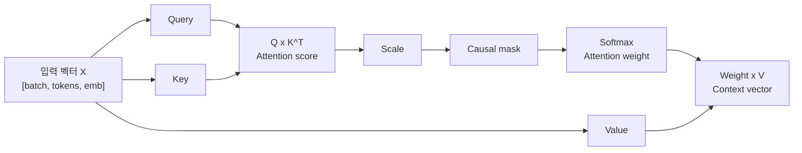

# Chap3. Attention과 Multi-Head Attention

참고 자료: `../pdf/AI-Application-Specialist-LLM-20260420_part1.pdf` 중 슬라이드 95-117 전후

## 이 장을 왜 배우는가

Attention은 Transformer의 핵심입니다. 이전 RNN 계열 모델은 순서대로 정보를 처리하는 경향이 강했지만,
Attention은 한 토큰이 다른 토큰들을 직접 참고해 자기 표현을 갱신할 수 있게 합니다.

이 장의 핵심 질문은 하나입니다.

> 현재 토큰이 문맥 속 다른 토큰들을 얼마나 참고해야 하는가?

GPT에서는 여기에 causal mask를 추가해, 미래 토큰을 보지 못하게 만듭니다.

## 한눈에 보는 흐름



## 학습 목표

- Q, K, V가 각각 어떤 역할을 하는지 설명할 수 있다.
- attention score가 query와 key의 내적으로 계산됨을 이해한다.
- softmax 이후 attention weight가 value의 가중합에 쓰인다는 것을 이해한다.
- causal mask가 GPT에서 미래 토큰을 가리는 역할을 한다는 것을 설명할 수 있다.
- multi-head attention이 여러 관점의 attention을 병렬로 계산한다는 것을 이해한다.

## 1. Attention의 직관

문장 안의 어떤 단어를 이해하려면 주변 단어가 필요합니다.

```text
"The animal didn't cross the street because it was too tired."
```

여기서 `it`이 무엇을 가리키는지 판단하려면 앞의 단어들을 참고해야 합니다.
Attention은 이런 "참고 정도"를 숫자로 계산합니다.

각 토큰은 다른 토큰들을 모두 바라보고, 얼마나 중요한지 weight를 만든 뒤,
중요한 토큰의 value를 더 많이 섞어 새로운 표현을 만듭니다.

## 2. Q, K, V는 같은 입력에서 나온 세 가지 역할이다

입력 token embedding `x`에서 세 개의 projection을 만듭니다.

```text
Q = xWq
K = xWk
V = xWv
```

직관:

| 이름 | 질문 |
|---|---|
| Query | 현재 토큰이 무엇을 찾고 있는가? |
| Key | 각 토큰은 어떤 특징으로 검색될 수 있는가? |
| Value | 실제로 가져올 정보는 무엇인가? |

Q와 K는 "얼마나 관련 있는지"를 계산하는 데 쓰이고,
V는 "관련 있다고 판단된 정보를 실제로 가져오는 데" 쓰입니다.

## 3. Attention score는 Q와 K의 내적이다

각 query는 모든 key와 내적을 합니다.

```text
scores = Q @ K.T
```

Shape 관점:

```text
Q:      [tokens, d_k]
K.T:    [d_k, tokens]
scores: [tokens, tokens]
```

`scores[i, j]`는 i번째 토큰이 j번째 토큰을 얼마나 참고할지에 대한 원시 점수입니다.

## 4. Scaling을 하는 이유

`d_k`가 커질수록 내적 값의 크기도 커질 수 있습니다.
점수가 너무 커지면 softmax가 한쪽으로 지나치게 쏠리고 gradient가 불안정해질 수 있습니다.

그래서 보통 다음처럼 나눕니다.

```text
scaled_scores = scores / sqrt(d_k)
```

이 연산은 Attention을 안정적으로 학습시키기 위한 정규화에 가깝습니다.

## 5. Causal mask는 미래 토큰을 가린다

GPT는 왼쪽에서 오른쪽으로 다음 토큰을 예측합니다.
따라서 현재 위치에서 미래 토큰을 보면 안 됩니다.

예를 들어 4개 토큰이 있다면 각 위치가 볼 수 있는 범위는 다음과 같습니다.

```text
token 0 -> token 0만 볼 수 있음
token 1 -> token 0, 1 볼 수 있음
token 2 -> token 0, 1, 2 볼 수 있음
token 3 -> token 0, 1, 2, 3 볼 수 있음
```

미래 위치의 score에는 매우 작은 값, 보통 `-inf`를 넣습니다.
그러면 softmax 이후 해당 위치의 weight가 0에 가까워집니다.

## 6. Softmax 이후 weight로 V를 섞는다

Attention weight는 각 row의 합이 1인 분포처럼 됩니다.
이 weight를 value에 곱하면 context vector가 만들어집니다.

```text
context = attention_weights @ V
```

Shape:

```text
attention_weights: [tokens, tokens]
V:                 [tokens, d_v]
context:           [tokens, d_v]
```

즉, 각 토큰의 새 표현은 다른 토큰 value들의 가중합입니다.

## 7. Multi-head attention은 여러 관점을 동시에 본다

한 개의 attention만 쓰면 하나의 유사도 관점에 의존합니다.
Multi-head attention은 embedding 차원을 여러 head로 나누어,
각 head가 서로 다른 관계를 학습하게 합니다.

예를 들어 어떤 head는 문법적 관계를, 어떤 head는 지시어 관계를,
다른 head는 가까운 단어 패턴을 보는 식으로 역할이 분화될 수 있습니다.

일반적인 흐름:

```text
입력 X
=> head별 Q/K/V 계산
=> head별 attention
=> head 결과 concat
=> output projection
```

## 코드 관점에서 꼭 볼 것

Attention 실습에서는 shape를 놓치지 않는 것이 가장 중요합니다.

대표 흐름:

```text
inputs:      [tokens, emb_dim]
batch:       [batch, tokens, emb_dim]
Q/K/V:       [batch, tokens, head_dim]
scores:      [batch, tokens, tokens]
mask 적용:   [batch, tokens, tokens]
weights:     [batch, tokens, tokens]
context:     [batch, tokens, head_dim]
multi-head:  [batch, tokens, num_heads, head_dim]
concat 후:   [batch, tokens, emb_dim]
```

PyTorch 코드에서 특히 볼 함수:

- `nn.Linear`: Q/K/V projection
- `torch.matmul` 또는 `@`: attention score 계산
- `transpose`: K를 전치하거나 head 차원을 옮길 때 사용
- `masked_fill_`: mask 위치에 `-inf`를 채움
- `softmax(dim=-1)`: 마지막 차원, 즉 "참고할 토큰들"에 대해 정규화
- `view`, `reshape`: head 분리/병합

## Attention 계산 순서 요약

```text
1. 입력 token embedding X를 준비한다.
2. X에서 Q, K, V를 만든다.
3. Q와 K의 내적으로 attention score를 계산한다.
4. score를 sqrt(d_k)로 나눈다.
5. GPT라면 causal mask로 미래 토큰을 가린다.
6. softmax로 attention weight를 만든다.
7. attention weight와 V를 곱해 context vector를 만든다.
8. 여러 head 결과를 합쳐 다음 layer로 보낸다.
```

## 자주 헷갈리는 지점

1. Q, K, V는 서로 다른 입력이 아니라 같은 입력에서 나온 다른 projection입니다.
2. attention score 자체가 최종 출력은 아닙니다. score는 softmax를 거쳐 value를 섞는 weight가 됩니다.
3. causal mask는 padding mask와 목적이 다릅니다. causal mask는 미래 차단, padding mask는 가짜 토큰 무시입니다.
4. multi-head는 여러 attention layer를 깊게 쌓는 것이 아니라, 같은 layer 안에서 병렬 attention을 여러 개 계산하는 것입니다.

## 수업 중 질문

- Q와 K를 분리하지 않고 같은 projection만 쓰면 어떤 표현력이 줄어들까?
- `softmax(dim=-1)`에서 `dim`을 잘못 지정하면 어떤 문제가 생길까?
- causal mask가 없다면 GPT 학습 loss는 왜 비정상적으로 좋아질 수 있을까?
- head 수를 늘리면 항상 성능이 좋아질까?

## 이 장을 배우고 나면

Transformer의 핵심 계산인 self-attention을 shape와 의미 관점에서 읽을 수 있습니다.
이제 Chap4에서 GPT block을 볼 때, attention이 전체 구조 안에서 어떤 역할을 하는지 연결할 수 있습니다.

