# Chap4. GPT 구조와 텍스트 생성

참고 자료: `../pdf/AI-Application-Specialist-LLM-20260420_part2.pdf` 중 슬라이드 1-31 전후

## 이 장을 왜 배우는가

Chap3에서 Attention 하나의 계산을 배웠다면, Chap4는 그것을 실제 GPT 모델 구조 안에 배치합니다.
GPT는 embedding, positional information, Transformer block, output head를 연결해 다음 토큰 확률을 만듭니다.

이 장의 핵심은 "GPT가 어떻게 입력 토큰을 다음 토큰 확률로 바꾸는가"입니다.

## 전체 구조 Overview

```mermaid
%%{init: {
  'theme': 'base',
  'themeVariables': {
    'fontFamily': 'Georgia, "Times New Roman", "Noto Serif KR", serif',
    'fontSize': '13px',
    'primaryTextColor': '#0f172a',
    'lineColor': '#334155',
    'edgeLabelBackground': '#ffffff'
  },
  'flowchart': { 'curve': 'basis', 'nodeSpacing': 26, 'rankSpacing': 34, 'padding': 10 }
}}%%
flowchart LR
    subgraph IN["1. Input & Embedding Layer"]
        direction TB
        Text["<b>Prompt Text</b>"] --> Tok["<b>Tokenizer</b>"]
        Tok --> IDs["<b>Token IDs (idx)</b><br/>ℤ^{B × T}"]
        IDs --> TE["<b>Token Emb W_e</b><br/>ℝ^{B × T × d}"]
        IDs --> PE["<b>Pos Emb W_p</b><br/>ℝ^{T × d}"]
        TE & PE --> Add(["<b>⊕ Sum & Dropout</b><br/>h^(0) ∈ ℝ^{B × T × d}"])
    end

    subgraph STACK["2. Decoder Stack (× N)"]
        direction TB
        Block1["<b>Pre-LN Transformer Block × N</b><br/>Masked MHA + Position-wise FFN<br/>h^(N) ∈ ℝ^{B × T × d}"]
    end

    subgraph HEAD["3. LM Head & Autoregressive Decoding"]
        direction LR
        Norm["<b>Final LayerNorm</b><br/>ℝ^{B × T × d}"]
        Head["<b>Linear LM Head</b><br/>Logits z ∈ ℝ^{B × T × |V|}"]
        Decode["<b>Last Step & Sampling</b><br/>z_{:, −1, :} / τ · Top-k · Softmax"]
        Next["<b>Next Token u_{T+1}</b><br/>ℤ^{B × 1}"]
        Norm --> Head --> Decode --> Next
    end

    Add --> Block1 --> Norm
    Next -. "Autoregressive Append: idx ← [idx, u_{T+1}]" .-> IDs

    classDef data fill:#eef4fa,stroke:#3b6998,stroke-width:1.5px,color:#0f172a;
    classDef emb fill:#fceef2,stroke:#b83b5e,stroke-width:1.5px,color:#0f172a;
    classDef blk fill:#fff3e6,stroke:#d97706,stroke-width:1.8px,color:#0f172a;
    classDef norm fill:#fefce8,stroke:#ca8a04,stroke-width:1.5px,color:#0f172a;
    classDef head fill:#e8f6f9,stroke:#0284c7,stroke-width:1.5px,color:#0f172a;
    classDef prob fill:#ecfdf5,stroke:#059669,stroke-width:1.5px,color:#0f172a;

    class Text,Tok,IDs,Next data;
    class TE,PE emb;
    class Add,Norm norm;
    class Block1 blk;
    class Head head;
    class Decode prob;
    style IN fill:#f8fafc,stroke:#64748b,stroke-width:1.2px,stroke-dasharray: 4 3,color:#0f172a
    style STACK fill:#f8fafc,stroke:#64748b,stroke-width:1.2px,stroke-dasharray: 4 3,color:#0f172a
    style HEAD fill:#f8fafc,stroke:#64748b,stroke-width:1.2px,stroke-dasharray: 4 3,color:#0f172a
```



## 학습 목표

- GPT가 decoder-only Transformer 구조임을 이해한다.
- residual connection, normalization, dropout의 역할을 설명할 수 있다.
- FFN이 attention 이후 각 토큰 표현을 변환하는 MLP임을 이해한다.
- output head가 hidden state를 vocabulary logits로 바꾼다는 것을 설명할 수 있다.
- temperature, top-k sampling이 생성 결과에 어떤 영향을 주는지 이해한다.

## 1. GPT는 decoder-only Transformer다

Transformer 원 논문 구조에는 encoder와 decoder가 모두 있지만,
GPT 계열은 decoder 쪽 구조를 언어 모델링에 맞게 사용합니다.

특징:

- 입력을 왼쪽에서 오른쪽으로 처리한다.
- causal mask를 사용해 미래 토큰을 보지 못하게 한다.
- 각 위치에서 다음 토큰을 예측한다.
- 생성할 때는 예측한 토큰을 다시 입력 뒤에 붙이고 반복한다.

## 2. GPT 입력은 token embedding과 position embedding의 합이다

토큰 ID만으로는 단어의 의미를 벡터화할 수 있지만, 순서 정보는 부족합니다.
그래서 GPT는 token embedding과 position embedding을 더합니다.

```text
input_ids: [batch, seq_len]
token_emb: [batch, seq_len, emb_dim]
pos_emb:   [seq_len, emb_dim]
x:         [batch, seq_len, emb_dim]
```

이 `x`가 Transformer block으로 들어갑니다.

## 3. Transformer block의 기본 구성

GPT block은 보통 다음 흐름을 가집니다.

```mermaid
%%{init: {
  'theme': 'base',
  'themeVariables': {
    'fontFamily': 'Georgia, "Times New Roman", "Noto Serif KR", serif',
    'fontSize': '13px',
    'primaryTextColor': '#0f172a',
    'lineColor': '#334155',
    'edgeLabelBackground': '#ffffff'
  },
  'flowchart': { 'curve': 'basis', 'nodeSpacing': 28, 'rankSpacing': 36, 'padding': 10 }
}}%%
flowchart LR
    X["<b>Block Input h^(l−1)</b><br/>ℝ^{B × T × d}"]

    subgraph SUB1["Sub-layer 1: Causal Self-Attention (Pre-LN)"]
        direction LR
        LN1["<b>LayerNorm 1</b><br/>LN(h^(l−1))"]
        MHA["<b>Masked MHA</b><br/>Causal Mask (j &gt; i)"]
        Drop1["<b>Dropout</b>"]
        LN1 --> MHA --> Drop1
    end

    Add1(["<b>⊕ Residual Add</b><br/>z^(l) = h^(l−1) + MHA(LN(h^(l−1)))"])

    subgraph SUB2["Sub-layer 2: Position-wise FFN (Pre-LN)"]
        direction LR
        LN2["<b>LayerNorm 2</b><br/>LN(z^(l))"]
        FFN["<b>Position-wise FFN</b><br/>Linear(d→4d) · GELU · Linear(4d→d)"]
        Drop2["<b>Dropout</b>"]
        LN2 --> FFN --> Drop2
    end

    Add2(["<b>⊕ Residual Add</b><br/>h^(l) = z^(l) + FFN(LN(z^(l)))"])
    Out["<b>Block Output h^(l)</b><br/>ℝ^{B × T × d}"]

    X --> LN1
    Drop1 --> Add1
    X -- "Identity Skip" --> Add1
    Add1 --> LN2
    Drop2 --> Add2
    Add1 -- "Identity Skip" --> Add2
    Add2 --> Out

    classDef data fill:#eef4fa,stroke:#3b6998,stroke-width:1.5px,color:#0f172a;
    classDef norm fill:#fefce8,stroke:#ca8a04,stroke-width:1.5px,color:#0f172a;
    classDef attn fill:#fff3e6,stroke:#d97706,stroke-width:1.5px,color:#0f172a;
    classDef ffn fill:#e8f6f9,stroke:#0284c7,stroke-width:1.5px,color:#0f172a;
    classDef reg fill:#f1f5f9,stroke:#64748b,stroke-width:1.5px,color:#334155;
    classDef op fill:#ecfdf5,stroke:#059669,stroke-width:1.5px,color:#0f172a;

    class X,Out data;
    class LN1,LN2 norm;
    class MHA attn;
    class FFN ffn;
    class Drop1,Drop2 reg;
    class Add1,Add2 op;
    style SUB1 fill:#f8fafc,stroke:#64748b,stroke-width:1.2px,stroke-dasharray: 4 3,color:#0f172a
    style SUB2 fill:#f8fafc,stroke:#64748b,stroke-width:1.2px,stroke-dasharray: 4 3,color:#0f172a
```



구현에 따라 LayerNorm 위치가 조금 다를 수 있습니다.
GPT-2 스타일 실습에서는 보통 pre-LayerNorm 구조를 사용합니다.

## 4. Residual connection은 정보와 gradient의 통로다

Residual connection은 layer의 출력에 원래 입력을 더합니다.

```text
x = x + attention(norm(x))
x = x + ffn(norm(x))
```

이 구조는 두 가지 면에서 중요합니다.

- 깊은 모델에서도 원래 정보가 지나갈 수 있다.
- gradient가 더 안정적으로 흐를 수 있다.

LLM처럼 block을 수십 개 이상 쌓는 모델에서는 residual connection이 사실상 필수입니다.

## 5. LayerNorm과 RMSNorm은 scale을 안정화한다

Normalization은 hidden vector의 값 분포가 지나치게 커지거나 작아지는 것을 막아 학습을 안정화합니다.

LayerNorm은 보통 feature dimension 기준으로 평균과 분산을 사용해 정규화합니다.
RMSNorm은 평균 제거 없이 root mean square를 사용하는 변형입니다.

개념적으로는 둘 다 "다음 연산이 다루기 쉬운 범위로 값을 맞춘다"는 목적을 가집니다.

## 6. Dropout은 과적합을 줄이기 위한 학습 중 노이즈다

Dropout은 학습 중 일부 activation을 임의로 0으로 만들어 특정 경로에 과하게 의존하지 않도록 합니다.
평가나 생성 시에는 보통 꺼집니다.

PyTorch에서는 다음 차이를 기억해야 합니다.

```python
model.train()  # dropout 켜짐
model.eval()   # dropout 꺼짐
```

생성 결과가 매번 이상하게 흔들린다면, 평가 모드 설정을 확인해야 합니다.

## 7. FFN은 각 토큰 위치에서 독립적으로 적용되는 MLP다

Attention은 토큰들 사이의 정보를 섞습니다.
FFN은 각 토큰의 hidden vector를 더 풍부하게 변환합니다.

일반적인 구조:

```text
Linear: emb_dim -> 4 * emb_dim
Activation: GELU
Linear: 4 * emb_dim -> emb_dim
```

Attention이 "어떤 토큰을 참고할지"라면,
FFN은 "참고한 정보를 어떻게 가공할지"에 가깝습니다.

## 8. Output head는 hidden state를 vocabulary 점수로 바꾼다

Transformer block을 통과한 출력은 아직 token 확률이 아닙니다.
마지막 linear layer가 각 위치의 hidden vector를 vocabulary 크기의 logits로 바꿉니다.

```text
hidden: [batch, seq_len, emb_dim]
logits: [batch, seq_len, vocab_size]
```

다음 토큰 생성에서는 보통 마지막 위치의 logits만 사용합니다.

```text
next_token_logits = logits[:, -1, :]
```

## 9. 생성은 "예측하고 붙이기"를 반복한다

GPT 생성 loop는 단순하지만 강력합니다.

```text
1. prompt를 token ID로 바꾼다.
2. 모델에 넣어 logits를 얻는다.
3. 마지막 위치의 logits를 뽑는다.
4. temperature, top-k 등을 적용한다.
5. 다음 token을 선택한다.
6. 선택한 token을 input 뒤에 붙인다.
7. 원하는 길이까지 반복한다.
```

## 10. Temperature와 top-k

Temperature는 logits의 sharpness를 조절합니다.

- 낮은 temperature: 높은 확률 토큰에 더 집중, 결과가 안정적
- 높은 temperature: 낮은 확률 토큰도 선택될 가능성 증가, 결과가 다양함

Top-k는 가장 점수가 높은 k개 토큰만 후보로 남깁니다.

- `k`가 작음: 안전하고 반복적일 수 있음
- `k`가 큼: 다양하지만 엉뚱한 토큰 가능성 증가

실무에서는 temperature, top-k, top-p 등을 함께 조절합니다.

## 코드 관점에서 꼭 볼 것

GPT 구현 코드를 볼 때는 module 단위와 shape 흐름을 함께 보세요.

```text
input_ids: [batch, seq_len]
tok_emb:   [batch, seq_len, emb_dim]
pos_emb:   [seq_len, emb_dim]
x:         [batch, seq_len, emb_dim]
block out: [batch, seq_len, emb_dim]
logits:    [batch, seq_len, vocab_size]
```

중요 모듈:

- `GPTModel`: 전체 모델
- `TransformerBlock`: attention + FFN + residual
- `MultiHeadAttention`: masked self-attention
- `LayerNorm`: 값 분포 안정화
- `FeedForward`: token-wise MLP
- `generate`: autoregressive decoding loop

## 자주 헷갈리는 지점

1. GPT의 출력은 바로 텍스트가 아니라 vocabulary logits입니다.
2. 다음 토큰 생성에는 전체 sequence의 logits 중 마지막 위치만 사용합니다.
3. dropout은 학습 중 regularization이고, 생성 시 다양성을 만드는 sampling과는 다릅니다.
4. FFN은 토큰 간 정보를 섞지 않습니다. 토큰 간 정보 혼합은 attention이 담당합니다.
5. residual connection은 단순한 덧셈이지만 깊은 모델 학습 안정성에 매우 중요합니다.

## 수업 중 질문

- causal mask가 있는데 position embedding도 필요한 이유는 무엇일까?
- 마지막 위치의 logits만 사용하는데, 이전 위치 logits는 왜 계산될까?
- temperature를 너무 낮게 설정하면 어떤 생성 문제가 생길까?
- FFN이 없다면 attention만으로 충분할까?

## 이 장을 배우고 나면

GPT 구현 파일을 열었을 때 각 class와 tensor shape가 어떤 흐름으로 연결되는지 이해할 수 있습니다.
또한 텍스트 생성이 모델의 신비한 능력이 아니라, 다음 토큰 예측 loop의 반복이라는 점을 명확히 알게 됩니다.

## 관련 FAQ

- [`model.eval()`은 무엇을 하나?](../docs/FAQ.md#modeleval은-무엇을-하나)
- [`with torch.no_grad():`를 쓰는 이유는?](../docs/FAQ.md#with-torchnograd를-쓰는-이유는)
- [예시에서 dropout을 끄고 직접 생성 loop를 수행하는 이유는?](../docs/FAQ.md#예시에서-dropout을-끄고-직접-생성-loop를-수행하는-이유는)
- [`torch.arange`는 무엇인가?](../docs/FAQ.md#torcharange는-무엇인가)
- [`idx_cond`에서 `cond`는 무슨 뜻인가?](../docs/FAQ.md#idx_cond에서-cond는-무슨-뜻인가)
- [Transformer block 안의 `emb_dim -> 4 * emb_dim -> GELU -> emb_dim`은 원래 구조인가?](../docs/FAQ.md#transformer-block-안의-emb_dim---4--emb_dim---gelu---emb_dim은-원래-구조인가)
