# Chap6. 분류 파인튜닝과 LoRA

참고 자료: `../pdf/AI-Application-Specialist-LLM-20260420_part2.pdf` 중 슬라이드 51-69 전후

## 이 장을 왜 배우는가

사전학습 모델은 일반적인 언어 패턴을 배웠지만, 특정 업무를 바로 잘 수행한다고 보장할 수는 없습니다.
예를 들어 스팸 분류, 감성 분류, 고객 문의 카테고리 분류처럼 명확한 label이 있는 문제는
fine-tuning을 통해 모델을 해당 작업에 맞춰 조정할 수 있습니다.

이 장은 classification fine-tuning과 parameter-efficient fine-tuning, 특히 LoRA를 다룹니다.

## 한눈에 보는 흐름

```mermaid
%%{init: {
  'theme': 'base',
  'themeVariables': {
    'fontFamily': 'Georgia, "Times New Roman", "Noto Serif KR", serif',
    'fontSize': '13px',
    'primaryTextColor': '#0f172a',
    'lineColor': '#334155',
    'edgeLabelBackground': '#ffffff'
  },
  'flowchart': { 'curve': 'basis', 'nodeSpacing': 26, 'rankSpacing': 34, 'padding': 10 }
}}%%
flowchart LR
    subgraph DATA["1. Classification Input"]
        direction TB
        Sample["<b>Labeled Sample (x, y)</b><br/>Text + Class y ∈ {1..C}"] --> Tok["<b>Tokenize & Right-Pad</b><br/>input_ids, attn_mask ∈ ℤ^{B×T}"]
    end

    subgraph LORA["2. LoRA Reparameterization (Hu et al., 2021)"]
        direction LR
        InX["<b>Layer Input x</b><br/>ℝ^{B × T × d}"]
        W0["<b>Frozen Pretrained W_0</b><br/>ℝ^{d × k} (requires_grad=False)"]
        MatA["<b>LoRA Down-Proj A</b><br/>ℝ^{d × r}, A ~ N(0, σ²)"]
        MatB["<b>LoRA Up-Proj B</b><br/>ℝ^{r × k}, B = 0 (r ≪ d)"]
        Sum(["<b>⊕ Scaled Merge</b><br/>h = xW_0 + (α/r)xAB"])

        InX -- "Frozen Path" --> W0 --> Sum
        InX -- "Trainable Low-Rank" --> MatA --> MatB --> Sum
    end

    subgraph HEAD["3. Classification Head & Objective"]
        direction LR
        Pool["<b>Last Valid Token</b><br/>h_{last} ∈ ℝ^{B × d}"]
        ClsHead["<b>Linear Classifier W_cls</b><br/>Logits z ∈ ℝ^{B × C}"]
        Loss["<b>Classification CE Loss</b><br/>ℒ_cls(z, y) → Update Only (A, B, W_cls)"]
        Pool --> ClsHead --> Loss
    end

    Tok --> InX
    Sum --> Pool

    classDef data fill:#eef4fa,stroke:#3b6998,stroke-width:1.5px,color:#0f172a;
    classDef frozen fill:#f1f5f9,stroke:#64748b,stroke-width:1.5px,stroke-dasharray: 4 2,color:#334155;
    classDef lora fill:#fff1f2,stroke:#e11d48,stroke-width:1.8px,color:#0f172a;
    classDef comp fill:#e8f6f9,stroke:#0284c7,stroke-width:1.5px,color:#0f172a;
    classDef head fill:#fff3e6,stroke:#d97706,stroke-width:1.5px,color:#0f172a;
    classDef loss fill:#ecfdf5,stroke:#059669,stroke-width:1.5px,color:#0f172a;
    classDef op fill:#fefce8,stroke:#ca8a04,stroke-width:1.5px,color:#0f172a;

    class Sample,Tok,InX data;
    class W0 frozen;
    class MatA,MatB lora;
    class Pool comp;
    class ClsHead head;
    class Loss loss;
    class Sum op;
    style DATA fill:#f8fafc,stroke:#64748b,stroke-width:1.2px,stroke-dasharray: 4 3,color:#0f172a
    style LORA fill:#f8fafc,stroke:#64748b,stroke-width:1.2px,stroke-dasharray: 4 3,color:#0f172a
    style HEAD fill:#f8fafc,stroke:#64748b,stroke-width:1.2px,stroke-dasharray: 4 3,color:#0f172a
```



## 학습 목표

- Fine-tuning이 사전학습 모델을 특정 작업에 맞게 조정하는 과정임을 이해한다.
- Classification fine-tuning에서 output head가 어떻게 바뀌는지 설명할 수 있다.
- Padding과 attention mask가 왜 필요한지 이해한다.
- Full fine-tuning과 PEFT의 차이를 설명할 수 있다.
- LoRA의 A/B low-rank matrix가 어떤 방식으로 기존 weight 업데이트를 대체하는지 이해한다.
- QLoRA와 quantization의 목적을 설명할 수 있다.

## 1. Fine-tuning은 이미 배운 표현을 작업에 맞게 재조정한다

사전학습 모델은 다음 토큰 예측을 통해 일반적인 언어 표현을 배웠습니다.
Fine-tuning은 이 모델을 특정 데이터셋과 목적 함수로 추가 학습합니다.

예:

| 작업 | 입력 | 출력 |
|---|---|---|
| 스팸 분류 | 이메일 텍스트 | spam / not spam |
| 감성 분류 | 리뷰 문장 | positive / negative |
| 의도 분류 | 사용자 발화 | 예약 / 취소 / 문의 |

이 장의 classification fine-tuning은 생성이 아니라 label 예측에 초점을 둡니다.

## 2. 분류 문제에서는 마지막 출력 구조가 달라진다

언어 모델 사전학습에서는 output head가 vocabulary logits를 만듭니다.

```text
logits: [batch, seq_len, vocab_size]
```

분류 fine-tuning에서는 class 개수만큼의 logits가 필요합니다.

```text
class_logits: [batch, num_classes]
```

그래서 보통 다음 중 하나를 사용합니다.

- 마지막 토큰의 hidden state를 classification head에 넣는다.
- `<cls>` 같은 대표 토큰의 hidden state를 사용한다.
- 여러 토큰 hidden state를 pooling해서 사용한다.

GPT 스타일에서는 마지막 유효 토큰의 hidden state를 쓰는 방식이 흔합니다.

## 3. Padding은 batch를 만들기 위해 필요하다

문장 길이는 제각각입니다. GPU에서 batch로 처리하려면 길이를 맞춰야 합니다.
짧은 문장 뒤에 `<pad>` 토큰을 붙여 동일한 길이로 만듭니다.

```text
sample A: [12, 45, 91, 7]
sample B: [33, 18]

padding 후:
sample A: [12, 45, 91, 7]
sample B: [33, 18, PAD, PAD]
```

하지만 PAD는 실제 텍스트가 아니므로 attention이나 loss에서 적절히 무시해야 합니다.
이를 위해 attention mask를 함께 사용합니다.

## 4. Classification loss는 class label에 대한 cross entropy다

분류에서는 target이 다음 토큰 시퀀스가 아니라 class ID입니다.

```text
class_logits: [batch, num_classes]
labels:       [batch]
loss:         scalar
```

예를 들어 `num_classes=2`이면 각 샘플마다 `[not_spam_score, spam_score]`가 나오고,
softmax 기준으로 더 높은 class를 예측합니다.

최종 예측은 보통 다음처럼 구합니다.

```python
preds = torch.argmax(class_logits, dim=-1)
```

## 5. Full fine-tuning의 비용

Full fine-tuning은 모델의 모든 파라미터를 업데이트합니다.
성능 면에서는 강력할 수 있지만 다음 비용이 큽니다.

- GPU 메모리 사용량 증가
- 학습 시간 증가
- task별로 전체 모델 checkpoint를 저장해야 함
- 작은 데이터셋에서는 과적합 위험

대형 LLM에서는 모든 파라미터를 업데이트하는 방식이 실무적으로 부담스러울 수 있습니다.

## 6. PEFT는 일부 파라미터만 학습한다

PEFT(Parameter-Efficient Fine-Tuning)는 대부분의 기존 모델 weight를 고정하고,
작은 추가 파라미터만 학습하는 접근입니다.

대표 방식:

- Adapter
- Prefix tuning
- Prompt tuning
- LoRA
- QLoRA

이 중 LoRA는 구현과 성능의 균형이 좋아 널리 쓰입니다.

## 7. LoRA의 핵심 아이디어

기존 linear layer의 weight 업데이트를 직접 학습하지 않고,
작은 두 행렬의 곱으로 표현합니다.

```text
원래: y = xW
LoRA: y = xW + x(BA) * scale
```

여기서 `W`는 고정하고, `A`, `B`만 학습합니다.
`A`, `B`의 rank가 작기 때문에 학습할 파라미터 수가 크게 줄어듭니다.

예를 들어 `W`가 `[4096, 4096]`이면 전체 파라미터는 약 1,677만 개입니다.
rank `r=8`인 LoRA를 쓰면 추가 파라미터는 대략 `4096*8 + 8*4096` 수준으로 줄어듭니다.

## 8. LoRA 초기화

LoRA에서는 보통 한 행렬은 random, 다른 행렬은 zero로 초기화합니다.
이렇게 하면 학습 시작 시점에는 LoRA branch가 원래 모델 출력을 거의 바꾸지 않습니다.

직관:

- 처음에는 사전학습 모델의 동작을 유지한다.
- 학습하면서 작은 low-rank update가 task에 맞게 조정된다.

## 9. 어디에 LoRA를 적용할까

LoRA는 주로 Transformer 내부의 linear projection에 적용합니다.

자주 적용되는 위치:

- attention의 query projection
- attention의 key/value projection
- attention output projection
- FFN의 linear layer

작업과 예산에 따라 일부 projection에만 적용하거나 더 넓게 적용할 수 있습니다.

## 10. QLoRA와 quantization

QLoRA는 base model을 낮은 bit로 quantize해 메모리를 줄이고,
LoRA adapter만 학습하는 방식입니다.

Quantization은 모델 weight를 더 낮은 정밀도로 저장하는 방법입니다.

| 형식 | 특징 |
|---|---|
| FP32 | 정확하지만 메모리 큼 |
| FP16/BF16 | 딥러닝 학습에서 널리 사용 |
| INT8/4-bit | 메모리 절감 큼, 정밀도 손실 관리 필요 |

QLoRA는 큰 모델을 제한된 GPU 메모리에서 fine-tuning할 때 특히 유용합니다.

## 코드 관점에서 꼭 볼 것

분류 fine-tuning 흐름:

```text
text batch
=> tokenizer
=> input_ids:      [batch, seq_len]
=> attention_mask: [batch, seq_len]
=> GPT backbone
=> hidden states:  [batch, seq_len, emb_dim]
=> selected state: [batch, emb_dim]
=> class head:     [batch, num_classes]
=> loss
```

LoRA 코드에서 확인할 것:

- base model weight의 `requires_grad`가 `False`인지
- LoRA A/B matrix의 `requires_grad`가 `True`인지
- trainable parameter 수가 얼마나 줄었는지
- inference 때 LoRA branch가 기존 linear output에 더해지는지

## 자주 헷갈리는 지점

1. LoRA는 모델을 작게 만드는 pruning이 아니라, 학습할 업데이트를 low-rank로 제한하는 방법입니다.
2. Base model이 고정되어도 forward 계산에는 여전히 base model이 사용됩니다.
3. Padding token은 실제 의미가 없으므로 마지막 토큰 선택 시 PAD 위치를 잘못 사용하면 분류 성능이 떨어질 수 있습니다.
4. Quantization은 저장/연산 정밀도를 줄이는 것이고, LoRA는 학습 파라미터 수를 줄이는 것입니다.

## 수업 중 질문

- 분류 fine-tuning에서 vocabulary head를 그대로 쓰면 어떤 문제가 있을까?
- 마지막 토큰 hidden state를 쓸 때 padding이 있으면 무엇을 조심해야 할까?
- LoRA rank를 높이면 어떤 장단점이 있을까?
- QLoRA가 메모리를 줄이는 지점은 어디일까?

## 이 장을 배우고 나면

사전학습 GPT를 특정 분류 문제에 맞게 바꾸는 흐름을 이해할 수 있습니다.
또한 LoRA가 왜 대형 모델 fine-tuning에서 중요한지, 코드에서 어떤 파라미터가 실제로 학습되는지 확인할 수 있습니다.

## 관련 FAQ

- [언더샘플링은 무엇이고 왜 쓰나?](../docs/FAQ.md#언더샘플링은-무엇이고-왜-쓰나)
- [LoRA의 A/B 행렬은 왜 보통 `A=random`, `B=zero`로 초기화하나?](../docs/FAQ.md#lora의-ab-행렬은-왜-보통-arandom-bzero로-초기화하나)
- [LoRA 적용과 classification `out_head` 교체 순서는 어떻게 잡아야 하나?](../docs/FAQ.md#lora-적용과-classification-out_head-교체-순서는-어떻게-잡아야-하나)
- [`.pth` 파일은 무엇인가?](../docs/FAQ.md#pth-파일은-무엇인가)
