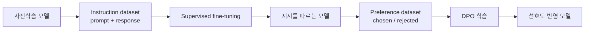

# Chap7. Instruction Tuning과 DPO

참고 자료: `../pdf/AI-Application-Specialist-LLM-20260420_part2.pdf` 중 슬라이드 70-91 전후

## 이 장을 왜 배우는가

사전학습 모델은 다음 토큰 예측을 잘하지만, 사용자의 지시를 잘 따르는 assistant라고 보기는 어렵습니다.
Instruction tuning은 모델이 질문, 요청, 명령에 맞게 답하도록 학습시키는 단계입니다.

그 다음에는 "어떤 답변이 더 좋은가"라는 사람의 선호를 반영해야 합니다.
기존에는 RLHF와 PPO 같은 강화학습 기반 방법이 많이 쓰였고,
DPO는 reward model과 복잡한 RL loop 없이 preference data를 직접 활용하는 방법입니다.

## 한눈에 보는 흐름



## 학습 목표

- Instruction tuning이 사전학습과 어떻게 다른지 설명할 수 있다.
- Prompt format이 학습과 추론 일관성에 왜 중요한지 이해한다.
- Instruction dataset에서 input, output, mask가 어떻게 구성되는지 이해한다.
- RLHF의 큰 흐름과 한계를 설명할 수 있다.
- DPO가 preference pair를 이용해 chosen response의 확률을 높이고 rejected response의 확률을 낮추는 방식임을 이해한다.
- Reference model과 KL 제약의 의미를 설명할 수 있다.

## 1. 사전학습 모델은 assistant가 아니다

사전학습 모델은 대량 텍스트에서 다음 토큰을 예측하도록 학습됩니다.
그래서 문장을 이어 쓰는 능력은 강하지만, 사용자의 의도를 따르는 방식이 일관적이지 않을 수 있습니다.

예를 들어 사용자가 "세 문장으로 요약해줘"라고 해도,
사전학습 모델은 지시를 따르기보다 인터넷 문서에서 이어질 법한 텍스트를 생성할 수 있습니다.

Instruction tuning은 이런 모델을 "지시-응답" 형식의 데이터로 추가 학습합니다.

## 2. Instruction dataset의 기본 형태

하나의 샘플은 보통 다음 구성입니다.

```text
instruction: 사용자가 원하는 작업
input:       작업에 필요한 추가 문맥
output:      기대 답변
```

실제 모델 입력은 특정 prompt template으로 합쳐집니다.

```text
### Instruction:
다음 문장을 긍정/부정으로 분류하세요.

### Input:
이 제품은 가격 대비 만족스럽습니다.

### Response:
긍정
```

중요한 점은 학습 때 사용한 format과 추론 때 사용하는 format이 최대한 일관되어야 한다는 것입니다.

## 3. SFT는 정답 응답을 따라 쓰도록 학습한다

SFT(Supervised Fine-Tuning)는 prompt와 정답 response를 하나의 sequence로 만들고,
response 부분의 token을 예측하도록 학습합니다.

```text
input sequence:
[instruction tokens][input tokens][response tokens]

loss:
response tokens에 대해서만 계산
```

Instruction 부분은 모델에게 조건으로 제공되는 문맥이고,
정답으로 맞혀야 하는 핵심 대상은 response입니다.

## 4. 왜 instruction 부분을 masking하는가

모델에게 이미 제공한 instruction token까지 정답으로 맞히게 하면,
학습 목표가 흐려질 수 있습니다.

보통은 prompt 부분의 label을 `-100` 등 ignore index로 두어 loss에서 제외합니다.

```text
tokens: [prompt prompt prompt response response]
labels: [-100   -100   -100   response response]
```

이렇게 하면 모델은 prompt를 조건으로 보고, response를 생성하는 방향으로 학습됩니다.

## 5. Padding과 target mask

Batch를 만들기 위해 padding이 필요합니다.
하지만 PAD token도 loss에서 제외해야 합니다.

따라서 instruction tuning 데이터에서는 두 종류의 무시할 토큰이 자주 등장합니다.

- prompt 영역: 조건으로만 사용, loss 제외
- padding 영역: 실제 데이터가 아니므로 loss 제외

PyTorch cross entropy에서는 ignore index를 활용해 이런 위치를 건너뜁니다.

## 6. RLHF의 큰 흐름

RLHF(Reinforcement Learning from Human Feedback)는 사람의 선호를 반영하기 위한 대표적인 접근입니다.
큰 흐름은 다음과 같습니다.

```text
1. SFT 모델을 만든다.
2. 같은 prompt에 대한 여러 답변을 생성한다.
3. 사람이 더 좋은 답변을 고른다.
4. preference data로 reward model을 학습한다.
5. PPO 같은 RL 알고리즘으로 policy model을 업데이트한다.
```

이 방식은 강력하지만 구현이 복잡하고, reward model과 RL training loop를 안정적으로 관리해야 합니다.

## 7. Preference data는 chosen/rejected pair로 표현된다

DPO나 reward model 학습에서는 다음 형태의 데이터가 자주 사용됩니다.

```text
prompt:    "짧게 요약해줘..."
chosen:    더 선호되는 답변
rejected:  덜 선호되는 답변
```

핵심은 절대 점수가 아니라 같은 prompt에 대해 어느 답변이 더 좋은지의 비교입니다.

## 8. DPO의 핵심 아이디어

DPO(Direct Preference Optimization)는 reward model을 따로 학습하고 PPO를 돌리는 대신,
preference pair를 이용해 language model을 직접 최적화합니다.

직관적으로는 다음 방향입니다.

- chosen response의 확률을 reference model 대비 더 높인다.
- rejected response의 확률은 reference model 대비 낮춘다.
- 하지만 원래 모델에서 너무 멀리 벗어나지 않도록 제약한다.

즉, "좋은 답변을 더 자주 내게 하되, 모델이 갑자기 이상한 분포로 튀지 않게" 만드는 방식입니다.

## 9. Reference model의 역할

DPO에서는 보통 학습 전 SFT 모델을 reference model로 둡니다.
Reference model은 업데이트하지 않고, 현재 학습 중인 policy model과 비교 기준으로 사용합니다.

비교하는 이유:

- chosen/rejected의 절대 확률만 보면 문장 길이와 난이도 영향을 크게 받을 수 있다.
- reference 대비 얼마나 선호 방향으로 이동했는지를 보면 안정적이다.
- 모델이 원래 언어 능력에서 과도하게 벗어나는 것을 억제할 수 있다.

## 10. KL divergence와 beta

KL divergence는 두 확률 분포가 얼마나 다른지 재는 척도입니다.
Alignment 학습에서는 policy model이 reference model에서 너무 멀리 벗어나지 않게 하는 역할로 등장합니다.

DPO의 `beta`는 선호 최적화의 강도를 조절하는 하이퍼파라미터로 이해할 수 있습니다.

- beta가 큼: reference와의 차이에 더 민감
- beta가 작음: 선호 데이터에 더 강하게 맞출 수 있음

실제 최적값은 데이터 품질과 모델 크기에 따라 달라집니다.

## 11. DPO 학습 데이터의 token-level 처리

DPO에서도 결국 모델은 token probability를 계산합니다.
각 prompt-response sequence에 대해 response token들의 log probability를 합산하거나 평균내어,
chosen과 rejected의 선호 차이를 loss로 만듭니다.

Shape 관점:

```text
prompt_ids:   [batch, prompt_len]
chosen_ids:   [batch, chosen_len]
rejected_ids: [batch, rejected_len]

policy logprob chosen
policy logprob rejected
reference logprob chosen
reference logprob rejected
=> DPO loss
```

Padding이 있으면 response의 실제 토큰만 log probability 계산에 포함해야 합니다.

## 코드 관점에서 꼭 볼 것

Instruction tuning 코드:

```text
raw instruction sample
=> prompt template 적용
=> tokenization
=> labels 생성
=> prompt/pad 위치 labels = ignore_index
=> causal LM loss
```

DPO 코드:

```text
prompt + chosen
prompt + rejected
=> policy model logprobs
=> reference model logprobs
=> chosen advantage와 rejected advantage 비교
=> DPO loss
```

체크포인트:

- prompt template이 학습/추론에서 같은가?
- response 영역에만 loss가 걸리는가?
- padding token이 loss와 logprob 계산에서 제외되는가?
- reference model은 `eval()` 상태이고 gradient update에서 제외되는가?

## 자주 헷갈리는 지점

1. SFT는 좋은 예시 답변을 따라 하게 만드는 단계이고, DPO는 선호되는 답변을 덜 선호되는 답변보다 더 높게 만들도록 조정하는 단계입니다.
2. DPO는 사람 피드백을 쓰지 않는다는 뜻이 아닙니다. Reward model 없이 preference data를 직접 쓴다는 뜻입니다.
3. Reference model은 정답 모델이 아니라, policy가 너무 멀리 벗어나지 않게 비교하는 기준입니다.
4. Prompt token에 loss를 걸지 않는다고 해서 prompt를 모델이 보지 않는 것은 아닙니다. 조건으로 보되 정답 예측 대상에서 제외하는 것입니다.

## 수업 중 질문

- 사전학습만 된 모델과 instruction-tuned 모델의 답변 스타일은 어떻게 다를까?
- Prompt template을 바꾸면 왜 성능이 흔들릴 수 있을까?
- Preference pair에서 chosen과 rejected의 길이가 크게 다르면 어떤 보정이 필요할까?
- DPO에서 reference model을 업데이트하면 어떤 문제가 생길까?

## 이 장을 배우고 나면

LLM이 단순히 다음 토큰 예측 모델에서 사용자 지시를 따르는 assistant로 바뀌는 과정을 이해할 수 있습니다.
또한 SFT, RLHF, DPO의 차이를 구분하고, preference alignment 코드에서 어떤 log probability가 비교되는지 읽을 수 있습니다.

## 관련 FAQ

- [Chapter 7에서 JSON의 `input`과 학습 tensor의 `inputs`는 어떻게 다른가?](../docs/FAQ.md#chapter-7에서-json의-input과-학습-tensor의-inputs는-어떻게-다른가)
- [SFT에서 `labels = [-100, -100, ...]`는 어디에 넣나?](../docs/FAQ.md#sft에서-labels---100--100-는-어디에-넣나)
- [DPO에서도 `-100` labels를 직접 넣어야 하나?](../docs/FAQ.md#dpo에서도--100-labels를-직접-넣어야-하나)
- [Chapter 7 SFT 예시에서 주의할 로직은?](../docs/FAQ.md#chapter-7-sft-예시에서-주의할-로직은)
